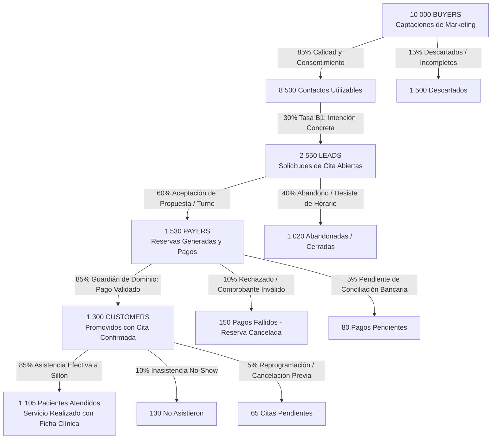

# Simulación Integral Coherente del Embudo: 10k Buyers hasta Customer

[Poblamiento 10k Buyer](POBLAMIENTO_BUYER_10K.md) · [Recomendaciones Fases](RECOMENDACIONES_OTRAS_FASES.md) · [Contrato Transición Customer](../../payer_revision/docs/CONTRATO_TRANSICION_CUSTOMER.md).

Este documento especifica la lógica de negocio, métricas de conversión clínica, coherencia temporal y scripts SQL para simular el embudo de ventas y atención odontológica completo de la clínica dental NexoSalud, partiendo de la cohorte de **10 000 Buyers** hasta la atención en sillón de los **Customers**.

---

## 1. Arquitectura y Tasas de Conversión del Embudo Odontológico

---

## 2. Métricas Cuantitativas Resumen

| Etapa del Embudo | Volumen | Tasa de Conversión | Entidades OLTP Involucradas | Evidencia y Reglas de Negocio |
|---|---:|---:|---|---|
| **1. BUYER** | **10 000** | 100.0% | `Personas`, `CaptacionesBuyer`, `Interacciones` | Identificados con dominio `@sim-buyer-10k-v1.invalid` y 5 campañas de captación. 8 500 con consentimiento explícito. |
| **2. LEAD** | **2 550** | **30.0%** (de utilizables) | `Solicitudes`, `Opciones`, `Disponibilidad` | Solicitudes abiertas. 92% con primera respuesta útil en < 15 min. 1 530 convertidas y 1 020 abandonadas. |
| **3. PAYER** | **1 530** | **60.0%** (de Leads) | `Reservas`, `Pagos`, `EventosEtapa` | Creadas tras aceptar la propuesta. 1 300 pagos validados (85%), 150 fallidos y 80 pendientes. Canales: Yape, Tarjeta Niubiz, Transferencia BCP, Caja. |
| **4. CUSTOMER** | **1 300** | **85.0%** (de Reservas) | `Personas`, `Atenciones`, `EventosEtapa` | Promovidos con *Guardián de Dominio*. Se emiten boletas/facturas electrónicas `BOL-EB01-XXXXXX`. |
| **Atendidos en Sillón** | **1 105** | **85.0%** (de Customers) | `Atenciones`, `Reservas` | Asistencia efectiva: 48.5 min promedio en sillón clínico, diagnóstico CIE-10 y procedimientos conformes. Tasa de No-show: 10%. |

---

## 3. Coherencia Financiera y Retorno

- **Inversión de Marketing (Simulada V1):** S/ 60 000 (distribuida en 12 meses).
- **Recaudación Bruta Validada:** ~S/ 243 000 (ticket promedio S/ 186.92 por reserva validada: consultas, profilaxis, ortodoncia inicial, curaciones).
- **Costo de Adquisición de Paciente Atendido (CAC):** `S/ 60 000 / 1 105 = S/ 54.30 por paciente en sillón`.
- **ROAS Inmediato (Retorno sobre Gasto Publicitario):** `4.05x`.

---

## 4. Scripts Disponibles en el Repositorio

1. **Poblamiento de los 10k Buyers (Base V1):**
   - `database/buyer_revision/semana9/simulacion/08_poblamiento_buyer_10k.sql`
2. **Poblamiento del Embudo Completo (Lead -> Payer -> Customer):**
   - `database/buyer_revision/semana9/simulacion/10_poblamiento_funnel_lead_payer_customer.sql`
3. **Validación y Conciliación del Embudo:**
   - `database/buyer_revision/semana9/simulacion/11_validacion_funnel_lead_payer_customer.sql`
