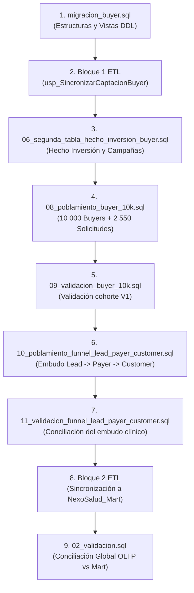

# Orden de Ejecución Secuencial: Simulación y Embudo Completo (10k Buyers hasta Customer)

Este documento detalla el procedimiento exacto de ejecución secuencial en **SQL Server** para replicar la simulación integral del embudo clínico-comercial de odontología (NexoSalud), abarcando desde la cohorte de **10 000 Buyers** hasta la atención en sillón de **Customer**, así como la sincronización dimensional hacia el Data Mart (`NexoSalud_Mart`).

---

## 1. Entorno y Requisitos Previos

- **Motor:** Microsoft SQL Server (2019, 2022 o 2025) en `localhost:1433`.
- **Bases de datos:** `NexoSaludDB` (OLTP) y `NexoSalud_Mart` (Dimensional).
- **Herramienta de ejecución:** SQL Server Management Studio (SSMS) o la utilidad de línea de comandos `sqlcmd` con autenticación integrada de Windows.
- **Servicio Backend:** Detener temporalmente `npm run dev` en el backend antes de ejecutar scripts DDL o cargas masivas para evitar bloqueos por transacciones concurrentes.

---

## 2. Ejecución Secuencial Realizada

Ejecutar estrictamente en el siguiente orden secuencial:



---

### Paso 1: Migración y Adaptación de Estructuras (DDL)
- **Archivo:** `database/buyer_revision/semana9/migracion_buyer.sql`
- **Propósito:** Prepara la tabla `CaptacionesBuyer`, columnas de trazabilidad en `EventosEtapa` (`clave_operacion_buyer`), vista `v_DatosCaptacionBuyer`, procedimiento `usp_ConvertirBuyerALead` y estructura atómica en el Mart `fact_captacion_buyer`.
- **Comando SQLCMD:**
  ```powershell
  sqlcmd -S localhost,1433 -E -C -i database\buyer_revision\semana9\migracion_buyer.sql
  ```

---

### Paso 2: Instalación del ETL Bloque 1 (Captación Buyer)
- **Archivo:** `database/buyer_revision/semana9/poblamiento_merge_mart.sql` (Líneas 10 a 337: Bloque 1)
- **Propósito:** Crea e instala el procedimiento canónico `dbo.usp_SincronizarCaptacionBuyer` y ejecuta la sincronización inicial.
- **Comando PowerShell:**
  ```powershell
  $lines = Get-Content database\buyer_revision\semana9\poblamiento_merge_mart.sql
  $b1 = $lines[9..336] -join "`r`n"
  Set-Content database\buyer_revision\semana9\bloque1_tmp.sql -Value $b1
  sqlcmd -S localhost,1433 -E -C -i database\buyer_revision\semana9\bloque1_tmp.sql
  Remove-Item database\buyer_revision\semana9\bloque1_tmp.sql
  ```

---

### Paso 3: Hecho de Inversión y Gasto Publicitario
- **Archivo:** `database/buyer_revision/semana9/06_segunda_tabla_hecho_inversion_buyer.sql`
- **Propósito:** Crea la tabla de hechos `fact_inversion_campana_buyer` en `NexoSalud_Mart` e instala el procedimiento `usp_SincronizarInversionCampanaBuyer`.
- **Comando SQLCMD:**
  ```powershell
  sqlcmd -S localhost,1433 -E -C -i database\buyer_revision\semana9\06_segunda_tabla_hecho_inversion_buyer.sql
  ```

---

### Paso 4: Poblamiento de la Cohorte 10k Buyers
- **Archivo:** `database/buyer_revision/semana9/simulacion/08_poblamiento_buyer_10k.sql`
- **Propósito:** Carga de forma atómica y aislada los **10 000 buyers sintéticos** (`@sim-buyer-10k-v1.invalid`), 8 500 contactos utilizables, 20 000 interacciones, S/ 60 000 en 60 gastos de campañas y 2 550 solicitudes abiertas con eventos de conversión. Sincroniza ambos hechos Buyer.
- **Comando SQLCMD:**
  ```powershell
  sqlcmd -S localhost,1433 -E -C -i database\buyer_revision\semana9\simulacion\08_poblamiento_buyer_10k.sql
  ```

---

### Paso 5: Validación de la Cohorte 10k Buyer
- **Archivo:** `database/buyer_revision/semana9/simulacion/09_validacion_buyer_10k.sql`
- **Propósito:** Comprueba que la cohorte V1 coincida exactamente con las reglas B1 (30%), B2 (85%), B3 (S/ 23.53 CPL) y conciliación cero entre OLTP y Mart.
- **Comando SQLCMD:**
  ```powershell
  sqlcmd -S localhost,1433 -E -C -i database\buyer_revision\semana9\simulacion\09_validacion_buyer_10k.sql
  ```
- **Resultado Esperado:** Mensaje final `OK: 10k, B1/B2/B3, eventos, costos por campana/mes y ambos hechos conciliados`.

---

### Paso 6: Poblamiento del Embudo Completo (Lead -> Payer -> Customer)
- **Archivo:** `database/buyer_revision/semana9/simulacion/10_poblamiento_funnel_lead_payer_customer.sql`
- **Propósito:** Continúa el embudo a partir de las 2 550 solicitudes generadas en el paso 4:
  1. **LEAD:** Actualiza tiempos de respuesta (< 15 min), opciones y ofertas; 1 530 solicitudes convertidas (60%) y 1 020 cerradas/abandonadas (40%).
  2. **PAYER:** Genera 1 530 reservas, crea slots en `Disponibilidad`, registra 1 530 pagos (Yape, Niubiz, BCP, Caja) y eventos LEAD -> PAYER.
  3. **Guardián de Dominio:** Valida 1 300 pagos (85%) con emisión de boletas/facturas electrónicas `BOL-EB01-XXXXXX`, cancela 150 reservas por pago fallido y deja 80 pendientes.
  4. **CUSTOMER:** Promueve los 1 300 pacientes a etapa `CUSTOMER`, registra eventos PAYER -> CUSTOMER y programa citas en sillón clínico en `dbo.Atenciones` (1 105 asistencias efectivas con servicio 'Realizado', 130 no-shows y 65 reprogramados).
- **Comando SQLCMD:**
  ```powershell
  sqlcmd -S localhost,1433 -E -C -i database\buyer_revision\semana9\simulacion\10_poblamiento_funnel_lead_payer_customer.sql
  ```
- **Resultado Esperado:** Mensaje final `>>> OK: EMBUDO COMPLETO SIMULADO Y CONCILIADO CON EXITO (10K BUYER -> CUSTOMER)`.

---

### Paso 7: Validación y Reporte del Embudo Clínico
- **Archivo:** `database/buyer_revision/semana9/simulacion/11_validacion_funnel_lead_payer_customer.sql`
- **Propósito:** Consulta y muestra el reporte cuantitativo del embudo por etapa, recaudación financiera y métricas de sillón.
- **Comando SQLCMD:**
  ```powershell
  sqlcmd -S localhost,1433 -E -C -i database\buyer_revision\semana9\simulacion\11_validacion_funnel_lead_payer_customer.sql
  ```

---

### Paso 8: Sincronización Dimensional hacia `NexoSalud_Mart` (Bloque 2)
- **Archivo:** `database/buyer_revision/semana9/poblamiento_merge_mart.sql` (Líneas 339 en adelante: Bloque 2)
- **Propósito:** Carga masiva de los hechos dimensionales `fact_negociacion_lead`, `fact_gestion_payer` y `fact_atencion_customer` en el Data Mart.
- **Comando PowerShell:**
  ```powershell
  $lines = Get-Content database\buyer_revision\semana9\poblamiento_merge_mart.sql
  $b2 = $lines[338..($lines.Count - 1)] -join "`r`n"
  Set-Content database\buyer_revision\semana9\bloque2_tmp.sql -Value $b2
  sqlcmd -S localhost,1433 -E -C -i database\buyer_revision\semana9\bloque2_tmp.sql
  Remove-Item database\buyer_revision\semana9\bloque2_tmp.sql
  ```

---

### Paso 9: Conciliación Global y Reporte Final
- **Archivo:** `database/buyer_revision/semana9/02_validacion.sql`
- **Propósito:** Ejecuta las pruebas de conciliación cruzada entre tablas transaccionales de `NexoSaludDB` y tablas de hechos de `NexoSalud_Mart`.
- **Comando SQLCMD:**
  ```powershell
  sqlcmd -S localhost,1433 -E -C -i database\buyer_revision\semana9\02_validacion.sql
  ```

---

## 3. Resultados Obtenidos tras la Ejecución

### A. Métricas de la Cohorte V1 (`11_validacion_funnel_lead_payer_customer.sql`)

| Etapa | Registros Totales | Registros Efectivos | Tasa / Observación |
|---|---:|---:|---|
| **1. BUYER** | 10 000 | 8 500 utilizables | **85.0%** calidad de datos y consentimiento explícito |
| **2. LEAD** | 2 550 | 1 530 convertidas a reserva | **30.0%** conversión Buyer -> Lead; **60.0%** aceptación Lead -> Reserva |
| **3. PAYER** | 1 530 | 1 300 pagos validados | **85.0%** validados por Tesorería (S/ 255 620.00 recaudados) |
| **4. CUSTOMER** | 1 300 | 1 105 asistencias a sillón | **85.0%** asistencia efectiva (10.0% no-show, 5.0% reprogramados) |

### B. Conciliación Transaccional vs. Data Mart (`02_validacion.sql`)

```
medida                 transaccional        dimensional          diferencia          
---------------------- -------------------- -------------------- --------------------
BUYER: contactos                      10807                10807                    0
LEAD: solicitudes                      2862                 2862                    0
PAYER: pagos                           1654                 1654                    0
PAYER: pagos validados                 1410                 1410                    0
CUSTOMER: citas                        1521                 1521                    0
TURNED: seguimientos                     80                   80                    0

Origen         Importe validado
-------------  ----------------
TRANSACCIONAL  S/ 274 720.00
DIMENSIONAL    S/ 274 720.00 (Diferencia = S/ 0.00)
```
