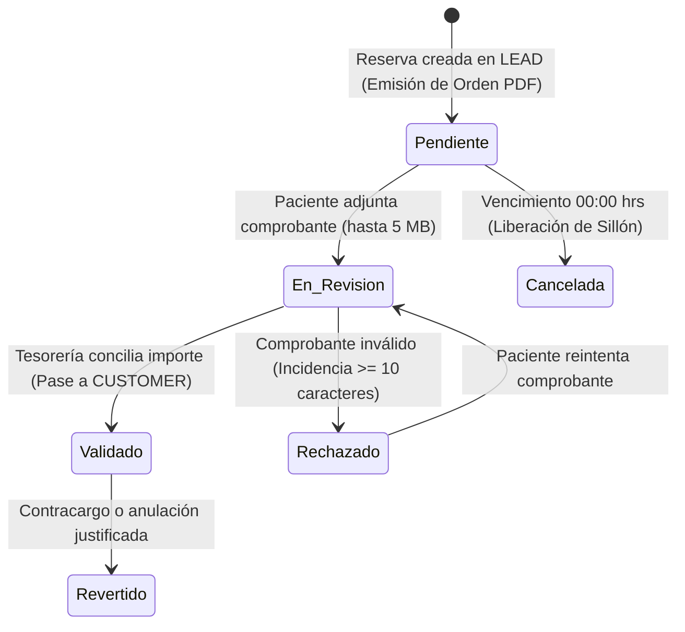

# Entrega de PAYER para los Equipos de CUSTOMER y TURNED

Esta es la guía técnica de integración para continuar con las etapas de **Atención Clínica (CUSTOMER)** y **Postventa / Retorno (TURNED)** sobre la base de datos **`NexoSaludDB`** y el Data Mart **`NexoSalud_Mart`**.

El equipo de **PAYER (Mario y Marck)** formalizó la gestión transaccional de cobros, la conciliación de comprobantes, la cadencia de cobranza automatizada en 3 etapas (*Dunning*) y la arquitectura dimensional dividida en tres tablas de hechos especializadas (`F1`, `F2`, `F3`).

---

## 1. Qué entrega PAYER en la Base de Datos

La intervención en la base de datos transaccional (`NexoSaludDB`) fue **estrictamente aditiva**, protegiendo las 30 tablas base y conservando todas las claves primarias y foráneas previas:

| Objeto Transaccional | Estado y Modificaciones Realizadas |
|---|---|
| `Pagos` | Se homologaron los estados operativos: `'Pendiente'`, `'En_Revision'`, `'Validado'`, `'Rechazado'` y `'Revertido'`. Se capturan montos, canales de pago, números de operación bancaria, fechas de validación y referencias a comprobantes digitales (máx. 5 MB). |
| `Reservas` | Mantiene el vínculo inquebrantable entre la persona, la solicitud y la opción acordada. Incorpora marcas de seguimiento de la cadencia de cobranza (`ultima_alerta_dunning`) y el score de riesgo asignado por IA (`score_riesgo_impago`). |
| `Incidencias` | Se enlaza formalmente a `Pagos` (`id_pago`) y `Reservas` (`id_reserva`). Exige justificaciones obligatorias ($\ge 10$ caracteres) para cualquier rechazo o reversión de pago. |
| `Disponibilidad` | Se libera automáticamente (`disponible = 1`) cuando una reserva alcanza las 00:00 hrs del día de la cita sin confirmación de pago, evitando sillones dentales ociosos. |

En el **Data Mart (`NexoSalud_Mart`)**, se supera el modelo monolítico previo creando 3 hechos especializados:
1. `Fact_RecaudacionPayer` (F1): Flujo financiero e ingresos brutos por pasarela y estado.
2. `Fact_ValidacionIncidenciaPayer` (F2): Tiempos de validación contable y motivos de rechazo/incidencias.
3. `Fact_ConversionCobranzaPayer` (F3): Cadencia de alertas y protección de sillones médicos frente a la cancelación por impago.

---

## 2. De LEAD a PAYER: Entrada de Datos

1. **Formalización del Acuerdo Comercial:**  
   Cuando en la mesa de negociación (LEAD) el paciente acepta una propuesta u opción específica, se genera un registro en `Reservas` con `estado = 'Pendiente'`.
2. **Consistencia de la Terna de Negociación:**  
   PAYER verifica rigurosamente que coincidan:
   - `Reservas.id_persona`
   - `Reservas.id_solicitud`
   - `Reservas.id_opcion`  
   Esta terna garantiza que el precio facturado corresponda exactamente al descuento y condiciones acordadas con el negociador comercial.
3. **Emisión de la Proforma / Orden de Pago:**  
   Al nacer la reserva en estado `Pendiente`, el sistema emite automáticamente la **Orden de Pago Oficial en PDF** con el desglose de tarifa oficial, descuento aplicado, cuentas corrientes bancarias y códigos QR (Yape/Plin).

---

## 3. Ciclo de Cobranza y Cadencia Automatizada (Dunning)

El cobro transita por los siguientes estados:

- **Cadencia de Protección de Agenda (Motor Dunning):**
  - **T - 48h:** Envío de recordatorio preventivo con PDF por correo y link de pago.
  - **T - 24h:** Alerta de urgencia clínica advirtiendo la liberación del turno a las 23:59 hrs.
  - **T = 00:00 hrs:** Cancelación automática de la reserva y liberación inmediata del sillón en la disponibilidad clínica.

---

## 4. Contrato Formal Hacia CUSTOMER (Atención Clínica)

> [!IMPORTANT]
> **El Validador de Dominio Principal:**  
> Ningún paciente puede ingresar a la agenda clínica presencial ni ser atendido en sillón dental si no cuenta con al menos un pago en estado formal **`Validado`**.

### Reglas para el Equipo de CUSTOMER:
1. **Pase Automático y Creación de la Atención:**  
   Al validar el pago en PAYER (vía `POST /api/payer/:id/validate`), el sistema ejecuta atómicamente:
   - Actualización de `Personas.id_etapa_actual = 4` (etapa `CUSTOMER`).
   - Inserción del registro en la tabla `Atenciones` con:
     - `id_persona`: Heredado de la reserva.
     - `id_reserva`: Referencia directa a la reserva pagada.
     - `id_servicio`: Tratamiento acordado.
     - `id_profesional`: Profesional asignado en la disponibilidad.
     - `id_sede`: Sede física correspondiente.
     - `fecha_atencion`: Fecha y hora de la cita.
     - `estado_servicio = 'Programado'`.
     - `asistencia = 'Pendiente'`.
   - Emisión de la **Constancia de Pago Oficial (PDF tipo RECEIPT)** con sello "PAGADO", N° de operación y confirmación de cita.
2. **No Reescritura Financiera:**  
   El módulo CUSTOMER debe registrar la evolución clínica, motivo de consulta, procedimientos e insumos en `Atenciones` **sin modificar ni reescribir los montos ni estados de `Pagos` ni de `Reservas`**.
3. **Manejo de Inasistencias (No-Show):**  
   Si el paciente no asiste a su cita, CUSTOMER debe marcar `Atenciones.asistencia = 'No asistió'` y `estado_servicio = 'Cancelado'`. Esto alimenta directamente la métrica `CitasConInasistencia` en el Data Mart sin alterar el cobro ya conciliado en PAYER.

---

## 5. Contrato Formal Hacia TURNED (Postventa y Seguimientos)

1. **Trazabilidad de la Persona y la Atención:**  
   Al finalizar el acto médico (`Atenciones.estado_servicio = 'Realizado'`), la persona pasa a `TURNED`. Los seguimientos deben registrarse en `Seguimientos` apuntando a `id_atencion` y conservando `id_persona`.
2. **Tratamiento de Incidencias Post-Atención:**  
   Si surge un reclamo médico o disconformidad en postventa, se registra en `Incidencias` apuntando a `id_atencion`, manteniéndose claramente diferenciadas de las incidencias de recaudación (que apuntan a `id_pago`).
3. **Reactivación de Pacientes (Nueva Solicitud):**  
   Si en la etapa TURNED el paciente solicita un nuevo tratamiento, se reutiliza su `id_persona` existente y se crea una nueva `Solicitud`, reiniciando el ciclo sin duplicar la identidad física ni perder su histórico de pagos anteriores.

---

## 6. Indicadores de Gestión PAYER (P1 – P4)

Los indicadores calculados para esta etapa se basan en los hechos dimensionales:

| KPI | Nombre | Fórmula Dimensional | Semáforo |
|---|---|---|---|
| **P1** | **Tasa de Pagos Validados** | `[Σ Fact_RecaudacionPayer.PagosValidados / Σ PagosRegistrados] × 100` | 🟢 $\ge 80\%$ · 🟡 $60-79\%$ · 🔴 $<60\%$ |
| **P2** | **Tiempo Promedio de Validación** | `Σ Fact_ValidacionIncidenciaPayer.TiempoTotalValidacionMin / Σ PagosValidados` | 🟢 $\le 60\text{ min}$ · 🟡 $61-120\text{ min}$ · 🔴 $>120\text{ min}$ |
| **P3** | **Tasa de Pagos Rechazados** | `[Σ Fact_RecaudacionPayer.PagosRechazados / Σ PagosRegistrados] × 100` | 🟢 $\le 5\%$ · 🟡 $6-10\%$ · 🔴 $>10\%$ |
| **P4** | **Tasa de Conversión a CUSTOMER** | `[Σ Fact_ConversionCobranzaPayer.ConversionesACustomer / Σ ReservasPreagendadas] × 100` | 🟢 $\ge 90\%$ · 🟡 $75-89\%$ · 🔴 $<75\%$ |

---

## 7. Scripts para Ejecutar

1. Para actualizar la base OLTP con las extensiones aditivas:  
   [`sql/01_oltp_payer_extension.sql`](sql/01_oltp_payer_extension.sql)
2. Para crear las dimensiones y hechos en el Data Mart:  
   [`sql/02_mart_dimensiones_payer.sql`](sql/02_mart_dimensiones_payer.sql) y [`sql/03_mart_facts_payer.sql`](sql/03_mart_facts_payer.sql)
3. Para ejecutar la carga ETL incremental idempotente:  
   [`sql/04_etl_poblamiento_payer.sql`](sql/04_etl_poblamiento_payer.sql)
4. Para auditar indicadores y reportes:  
   [`sql/05_indicadores_y_reportes_payer.sql`](sql/05_indicadores_y_reportes_payer.sql)

