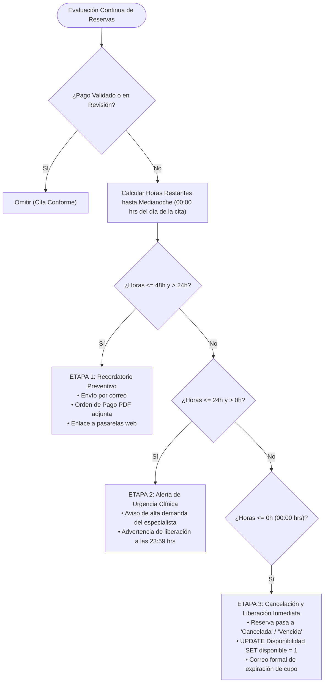

# Cadencia Automatizada de Cobranza (Dunning Scheduler) y Agente IA

Este documento describe la arquitectura y funcionamiento del motor automatizado de cobranza (*Dunning Scheduler*) y del Agente de Inteligencia Artificial (Groq / Llama 3) implementados en la fase **PAYER**.

---

## 1. Propósito y Problema Operativo que Resuelve

En las clínicas odontológicas, uno de los mayores focos de pérdida económica es la **incomparecencia o ausentismo de pacientes con cita pre-agendada (*no-show*)**. 
Cuando un paciente reserva un turno pero no realiza el pago correspondiente y no asiste:
- El sillón dental queda bloqueado y sin facturación.
- Se pierde la disponibilidad del odontólogo especialista.
- Se incurre en costos fijos de infraestructura sin retorno.

El motor de cadencia automatizada actúa como un **guardián de la agenda médica**, monitoreando de forma continua los plazos de vencimiento y liberando turnos médicos ante situaciones de impago sin requerir intervención humana.

---

## 2. El Ciclo de Cobranza en Tres Etapas

El servicio en segundo plano ([`dunningScheduler.ts`](file:///c:/Users/WIND%2011/Documents/Marck/Coding/Proyecto-IN-Odontolog-a-/backend/src/services/dunningScheduler.ts)) evalúa periódicamente todas las reservas activas en SQL Server basándose en la fecha programada de la cita con respecto a la hora oficial de Perú (`America/Lima`):



### Detalle de las Etapas:
1. **Etapa 1: Recordatorio Preventivo (T - 48h antes de la cita):**
   - Tono: Cordial, preventivo y asistencial.
   - Acción: Despacha un correo electrónico institucional mediante Nodemailer adjuntando la **Orden de Pago Oficial en PDF** con el desglose de tarifas y el link seguro de pago.
2. **Etapa 2: Alerta de Urgencia Clínica (T - 24h antes de la cita):**
   - Tono: Asertivo y de escasez clínica.
   - Acción: Comunica la alta demanda del sillón y advierte formalmente que la reserva caducará a las 23:59 hrs del día previo a la atención.
3. **Etapa 3: Cancelación Definitiva y Liberación de Sillón (T = 00:00 hrs del día de la cita):**
   - Acción en base de datos: Marca `Reservas.estado = 'Cancelada'` y ejecuta inmediatamente:
     ```sql
     UPDATE Disponibilidad 
     SET disponible = 1 
     WHERE id_disponibilidad = @IdDisponibilidad;
     ```
   - Resultado: El turno vuelve a estar visible y disponible en recepción y en la mesa de negociación (LEAD) para ser asignado a otro paciente.

---

## 3. Agente IA de Scoring de Riesgo y Rescate (Groq + Llama 3)

Integrado en el backend y en la interfaz de usuario ([`PayerDetailModal.tsx`](file:///c:/Users/WIND%2011/Documents/Marck/Coding/Proyecto-IN-Odontolog-a-/src/modules/payer/components/PayerDetailModal.tsx)), el Agente IA evalúa las variables contextuales de cada reserva mediante [`calculatePayerRisk()`](file:///c:/Users/WIND%2011/Documents/Marck/Coding/Proyecto-IN-Odontolog-a-/src/shared/services/groqService.ts):

- **Variables Evaluadas:** Horas restantes antes de la cita, monto a pagar, número de incidencias previas, canal de procedencia y existencia de comprobante adjunto.
- **Nivel de Riesgo Calculado:**
  - **BAJO (Score 0% – 39%):** Pacientes con historial limpio y margen de tiempo amplio.
  - **MODERADO (Score 40% – 64%):** Pacientes en la franja de 24h a 48h sin comprobante.
  - **ALTO (Score 65% – 100%):** Pacientes a menos de 24h con alta probabilidad de incomparecencia.

### Estrategia de Rescate 50% (`RESCUE_50`):
Para pacientes clasificados con riesgo **ALTO**, el agente genera automáticamente una propuesta comercial alternativa:
> *"Entendemos que coordinar la totalidad del tratamiento puede tomar tiempo. Para no perder tu cita con el especialista y conservar tu descuento del 30%, puedes asegurar tu sillón hoy abonando únicamente el 50% de la seña (S/ XX.XX). El saldo restante podrás liquidarlo en recepción el día de tu atención."*

El recepcionista dispone de un botón directo para copiar el texto o enviar el mensaje pre-redactado vía WhatsApp (`wa.me`) con un solo clic.

---

## 4. Consola de Auditoría en Tiempo Real

En el panel principal de PAYER ([`PayerPage.tsx`](file:///c:/Users/WIND%2011/Documents/Marck/Coding/Proyecto-IN-Odontolog-a-/src/modules/payer/pages/PayerPage.tsx)), los supervisores cuentan con un modal de auditoría en vivo del cron job:
- **Reloj en vivo:** Sincronizado segundo a segundo con el servidor.
- **Live Tail Polling:** Consulta cada 2 segundos a `/api/payer/dunning-stats` para observar la actividad en segundo plano.
- **Botón de Re-escaneo Forzado:** Permite disparar bajo demanda `POST /api/payer/run-dunning-cycle` para evaluar de inmediato todas las reservas de SQL Server.
- **Métricas Visibles en Pantalla:**
  - Reservas totales evaluadas.
  - Recordatorios preventivos remitidos.
  - Alertas de urgencia enviadas.
  - Cancelaciones procesadas por impago.
  - **Sillones dentales liberados exitosamente.**

