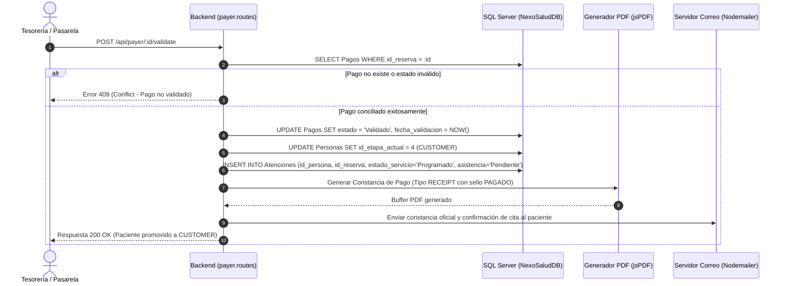

# Contrato de Transición Protegida Hacia CUSTOMER

Este documento formaliza la regla de negocio más crítica de la etapa **PAYER**: el **Guardián de Dominio** que autoriza el ingreso del paciente a la fase clínica (**CUSTOMER**).

---

## 1. El Principio del Guardián de Dominio

> **Regla de Oro:**  
> Ninguna atención odontológica puede ser programada como confirmada ni ejecutada en el sillón clínico si la reserva no cuenta con **al menos un pago formalmente conciliado y en estado `VALIDADO`**.

Esta regla protege a la clínica de dos riesgos operativos críticos:
1. **Descuadres financieros:** Previene la atención de pacientes con comprobantes falsos, transferencias no efectivizadas o montos inferiores a los pactados en la mesa de negociación.
2. **Ocupación injustificada de sillones:** Evita que el equipo clínico (odontólogo especialista y asistente) prepare el instrumental e insumos sin una garantía económica previa.

---

## 2. Flujo Transaccional de Validación y Transición

Cuando el personal de tesorería o la pasarela automática aprueba un cobro en la API (`POST /api/payer/:id/validate`), se ejecutan atómicamente los siguientes pasos en SQL Server:



### Código SQL Transaccional Equivalente:
```sql
BEGIN TRANSACTION;

-- 1. Actualizar el pago a Validado
UPDATE dbo.Pagos
SET estado = 'Validado',
    fecha_validacion = SYSDATETIME(),
    validado_por = @IdUsuarioValidador
WHERE id_pago = @IdPago AND id_reserva = @IdReserva;

-- 2. Promover la etapa actual de la persona
UPDATE dbo.Personas
SET id_etapa_actual = (SELECT id_etapa FROM dbo.Etapas WHERE nombre = 'CUSTOMER')
WHERE id_persona = @IdPersona;

-- 3. Crear el registro clínico en Atenciones si aún no existe
IF NOT EXISTS (SELECT 1 FROM dbo.Atenciones WHERE id_reserva = @IdReserva)
BEGIN
    INSERT INTO dbo.Atenciones (
        id_persona,
        id_reserva,
        id_servicio,
        id_profesional,
        id_sede,
        fecha_atencion,
        estado_servicio,
        asistencia
    ) VALUES (
        @IdPersona,
        @IdReserva,
        @IdServicio,
        @IdProfesional,
        @IdSede,
        @FechaAtencion,
        'Programado',
        'Pendiente'
    );
END

COMMIT TRANSACTION;
```

---

## 3. Emisión de la Constancia de Pago Oficial (PDF tipo RECEIPT)

Tras la validación, el componente de documentos PDF ([`paymentDocument.ts`](file:///c:/Users/WIND%2011/Documents/Marck/Coding/Proyecto-IN-Odontolog-a-/src/shared/pdf/paymentDocument.ts)) cambia su modo de operación de **Orden de Pago (Aviso)** a **Constancia Oficial de Pago**:

| Atributo del Documento | Orden de Pago (`ORDER` - Antes de Validar) | Constancia Oficial (`RECEIPT` - Tras Validar) |
|---|---|---|
| **Encabezado** | *"ORDEN DE PAGO PREVENTIVA"* | *"CONSTANCIA OFICIAL DE PAGO"* |
| **Sello de Agua** | Ninguno (o *"PENDIENTE"*) | **"PAGADO"** en verde esmeralda translúcido |
| **Datos Bancarios** | Despliega cuentas BCP, BBVA, Interbank y QR Yape | Se ocultan las cuentas; muestra la pasarela y N° de operación bancaria |
| **Código del Documento** | `ORD-XXXXX-2026` | `CONST-XXXXX-2026` con hash de validación |
| **Estado de la Cita** | *"Pre-reserva sujeta a plazo de caducidad"* | *"Cita Odontológica Confirmada en Agenda"* |

---

## 4. Obligaciones y Límites para el Módulo CUSTOMER

Para preservar la integridad del sistema, el módulo CUSTOMER debe acatar las siguientes pautas:
1. **Inmutabilidad Financiera:** La historia clínica y la atención no deben alterar el importe, fecha ni canal del pago registrado en PAYER.
2. **Pagos Adicionales en Clínica:** Si durante la atención el odontólogo agrega procedimientos o insumos con costo adicional, se debe registrar un nuevo registro en `Pagos` vinculado a la atención, sin sobreescribir la seña inicial de la reserva.
3. **Manejo de Inasistencia:** Si el paciente no asiste, se marca `Atenciones.asistencia = 'No asistió'` y `estado_servicio = 'Cancelado'`. El pago original permanece como validado en PAYER para efectos de auditoría contable.

