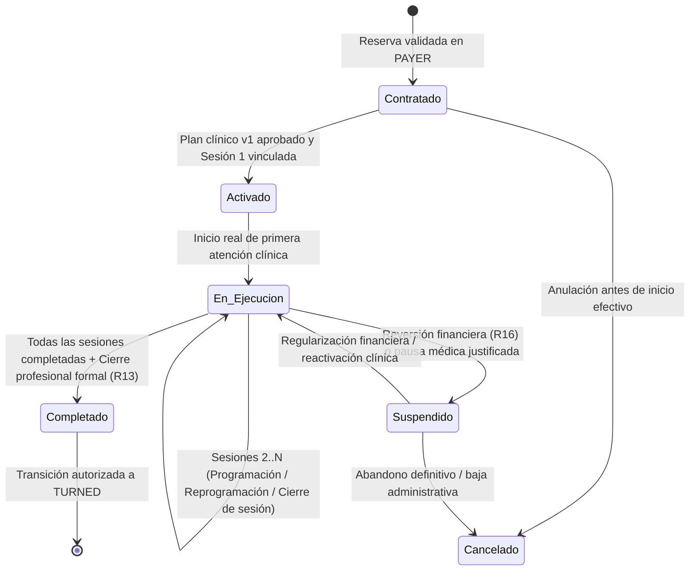

# CONTRATO DE INTEGRACIÓN Y FRONTERAS DE DOMINIO: PAYER → CUSTOMER → TURNED

**Proyecto:** NexoSalud — Clínica Odontológica  
**Versión de Contrato:** 2.0 (Integración Integral Fase CUSTOMER)  
**Bases de Datos:** `NexoSaludDB` (OLTP) y `NexoSalud_Mart` (Data Mart)  

---

## 1. LÍMITES Y RESPONSABILIDADES POR FASE

| Fase | Dominio y Responsabilidad Exclusiva | Prohibiciones Estrictas |
|---|---|---|
| **BUYER** | Captación inicial de interesados, consentimiento (`autoriza_contacto`) y calidad de identidad (`CaptacionesBuyer`). | CUSTOMER y TURNED no deben volver a crear filas en `Personas` ni en `CaptacionesBuyer` para un paciente ya identificado. |
| **LEAD** | Oportunidad comercial (`Solicitudes`), propuestas económicas (`PropuestasEconomicasLead`), descuentos y opciones de primera cita (`Opciones`). | CUSTOMER no debe sobrescribir precios de lista (`Tarifas`), precios ofrecidos (`Opciones.precio_ofrecido`) ni condiciones pactadas en LEAD. |
| **PAYER** | Formalización financiera de la reserva inicial (`Reservas`), conciliación de cobros (`Pagos`), cadencia Dunning (T-48h, T-24h, T-00:00) y gestión de incidencias/reversiones financieras. | CUSTOMER no modifica estados ni importes de `Pagos`. Todo cobro adicional o cuota posterior se tramita en el dominio PAYER sin alterar pagos ya validados. |
| **CUSTOMER** | Activación y ejecución del tratamiento contratado (`TratamientosContratados`), planes clínicos versionados (`PlanTratamiento`), gestión de sesiones (`SesionesTratamiento`, `EventosSesion`), prestación odontológica (`Atenciones`, `DetalleProcedimiento`), validación de fichas (`ValidacionesFicha`), indicaciones (`IndicacionesPostatencion`) y copiloto IA (`InteraccionesIA`, `AlertasIA`, `BorradoresIA`). | No confirmar primera cita ni iniciar atención sin Guardián Financiero satisfecho. No crear un nuevo tratamiento ni una nueva venta por cada sesión o reprogramación. No trasladar a TURNED por cerrar una sola sesión cuando el tratamiento sigue activo. |
| **TURNED** | Seguimiento postventa de tratamientos formalmente cerrados (`Seguimientos`), medición de satisfacción y apertura de nuevas oportunidades (`Solicitudes`) reutilizando el `id_persona` original. | No tratar consultas de sesiones pendientes de un tratamiento activo como postventa TURNED. |

---

## 2. GUARDIÁN DE DOMINIO: ENTRADA DESDE PAYER HACIA CUSTOMER

### 2.1. Eventos de Entrada y Validación Financiera Obligatoria (R01, R02, R03, R04)
Para que una reserva inicial de **PAYER** habilite la activación en **CUSTOMER** y permita confirmar/iniciar la primera atención clínica, la función `dbo.fn_VerificarGuardianFinancieroCustomer(@id_reserva)` y el procedimiento `dbo.usp_ActivarTratamientoDesdePayer` verifican atómicamente:

1. **Integridad de la Terna Comercial:**
   - Deben coincidir `Reservas.id_persona = Solicitudes.id_persona` y `Reservas.id_solicitud = Opciones.id_solicitud`.
   - La reserva no debe encontrarse en estado `'Cancelada'` ni `'Vencida'`.
2. **Existencia de Pago Oficialmente Validado:**
   - Debe existir al menos un registro en `dbo.Pagos` asociado a `id_reserva` con `estado = 'Validado'` (o `'Confirmado'` histórico migrado con evidencia verificada de conciliación: `fecha_validacion IS NOT NULL`, `referencia_pago IS NOT NULL`).
   - Ningún pago en estado `'Pendiente'`, `'En_Revision'`, `'Rechazado'` o `'Revertido'` habilita el guardián.
3. **Cumplimiento de Política de Importe Mínimo / Acuerdo Económico:**
   - El monto acumulado validado (`SUM(Pagos.importe)` con `estado = 'Validado'`) debe ser $> 0$ y cubrir el umbral exigible del acuerdo (`Opciones.precio_ofrecido` o el porcentaje de anticipo mínimo autorizado en el tratamiento, por defecto $\ge 30\%$ en tratamientos multisesión o $100\%$ en consulta única).
4. **No Duplicación en la Activación (Idempotencia):**
   - Si ya existe un `TratamientosContratados` para `id_reserva_origen = @id_reserva`, `dbo.usp_ActivarTratamientoDesdePayer` retorna los identificadores existentes (`ya_activado = 1`) sin duplicar el tratamiento, el plan, la primera sesión ni la atención programada.

### 2.2. Revalidación en Puntos de Entrada del Backend
El backend verifica el guardián en dos momentos independientes:
- **Al validar el cobro en PAYER** (`POST /api/payer/:id/validate`, `POST /api/payer/:id/convert-customer`, `validateAndPromotePayer`).
- **Antes de confirmar asistencia o iniciar la atención en CUSTOMER** (`PUT /api/customer/:id/state`, `POST /api/customer/:id/start-attention`, `PUT /api/customer/:id/attention-details`), bloqueando cualquier llamada directa a CUSTOMER si el pago fue revertido o no está validado.

---

## 3. CICLO DE VIDA DEL TRATAMIENTO Y SUS SESIONES EN CUSTOMER

### 3.1. Separación entre Primera Reserva (PAYER) y Sesiones Posteriores (CUSTOMER)
- **Sesión 1:** Se vincula a `id_reserva_origen` (la reserva pagada y conciliada en PAYER) sin crear una segunda reserva.
- **Sesiones $2..N$:** Se gestionan directamente en `dbo.SesionesTratamiento` dentro del tratamiento activo, verificando disponibilidad de sillón y profesional (`R05` — bloqueo anti-solapamiento sobre `(id_profesional, fecha, hora_inicio, hora_fin)`), **sin generar nuevas ventas en `Solicitudes` ni nuevas reservas comerciales iniciales**.
- **Reprogramaciones (`R06`, `R14`):** Reprogramar una sesión actualiza `SesionesTratamiento.fecha_programada_vigente` y `estado_programacion = 'Reprogramada'`, e inserta una fila inmutable en `dbo.EventosSesion` (`tipo_cambio = 'REPROGRAMACION'`). **Jamás crea una nueva fila en `SesionesTratamiento`**.

### 3.2. Ejecución Clínica, Validación de Ficha e Indicaciones Postatención
1. **Atención Realizada vs. Cierre Documental (`R09`, `R10`):**
   - Una atención puede finalizar en sillón (`Atenciones.estado_servicio = 'Realizado'`, `SesionesTratamiento.estado_asistencial = 'Realizada'`) quedando con `estado_cierre_documental = 'Pendiente'` y `SesionesTratamiento.estado_cierre = 'Pendiente'`.
   - Para que la sesión pase a `estado_cierre = 'Cerrada'` (computando en `sesiones_completadas`), se exige:
     - Al menos un procedimiento registrado en `DetalleProcedimiento` o en la atención.
     - Ficha clínica validada sin campos críticos pendientes (`ValidacionesFicha`).
     - Firma del profesional validador (`id_profesional_validador_cierre`).
2. **Inmutabilidad de la Primera Revisión de Ficha (`ValidacionesFicha`):**
   - La revisión `numero_revision = 1` conserva permanentemente el resultado inicial (`'Completa'` o `'Incompleta'`) para el cálculo honesto del indicador de calidad documental, aunque revisiones posteriores (`numero_revision = 2, 3...`) subsanen los campos pendientes.
3. **Indicaciones Postatención y Copiloto IA (`R17`, `R18`):**
   - El Agente Inteligente puede generar un borrador (`BorradoresIA` / `IndicacionesPostatencion` en estado `'Borrador'`), pero **ningún documento se marca como `'Aprobado'` ni `'Emitido'` sin el `id_profesional_aprobador` y `fecha_aprobacion` de un odontólogo habilitado**.
   - Editar el texto de un borrador actualiza su versión pero no multiplica el conteo de indicaciones emitidas.

---

## 4. REGLAS DE TRANSICIÓN CUSTOMER → TURNED Y MANEJO DE EXCEPCIONES

### 4.1. Cierre Formal del Tratamiento y Pase a TURNED (R11, R12, R13)
- **Prohibición de transición por sesión individual (`R12`):** Completar la sesión 1 de un tratamiento de 5 sesiones actualiza el avance del tratamiento (`sesiones_completadas`), pero mantiene `TratamientosContratados.estado_tratamiento = 'En ejecución'` y `Personas.id_etapa_actual = CUSTOMER`.
- **Condiciones para el pase a TURNED (`dbo.usp_CerrarTratamientoYTransicionarTurned`):**
  1. El plan vigente (`PlanTratamiento.es_vigente = 1`) tiene todas sus sesiones requeridas en `estado_cierre = 'Cerrada'` (`sesiones_completadas >= sesiones_planificadas`), o bien el profesional responsable registra un cierre clínico anticipado justificado.
  2. No existen sesiones ni atenciones del tratamiento con `estado_cierre_documental = 'Pendiente'`.
  3. El profesional responsable firma el cierre (`fecha_cierre_real = SYSDATETIME()`, `estado_tratamiento = 'Completado'`).
  4. Solo si la persona no mantiene otro tratamiento simultáneo en estado `'Activado'` o `'En ejecución'`, se actualiza `Personas.id_etapa_actual` a `TURNED` y se registra el evento en `dbo.EventosEtapa`.

### 4.2. Manejo de Reversiones Financieras Posteriores al Inicio Clínico (R16)
Cuando en PAYER ocurre una reversión bancaria o contracargo (`Pagos.estado = 'Revertido'`) después de haberse iniciado un tratamiento en CUSTOMER:
1. **Intangibilidad de la Historia Clínica:** Las atenciones, sesiones ya realizadas, procedimientos y fichas clínicas **nunca se eliminan ni se alteran** (protección médico-legal).
2. **Suspensión Preventiva de Sesiones Futuras:** El procedimiento `dbo.usp_ProcesarReversionFinancieraEnCustomer` cambia el tratamiento a `estado_tratamiento = 'Suspendido'` (`motivo_suspension_cancelacion = 'SUSPENSION_POR_REVERSION_FINANCIERA'`), registra una incidencia de alta prioridad y bloquea la ejecución de sesiones futuras pendientes hasta que PAYER registre un nuevo pago `'Validado'` que restablezca el guardián financiero.

### 4.3. Tratamientos Múltiples y Reactivación desde TURNED
- Un mismo `id_persona` puede tener múltiples filas en `dbo.TratamientosContratados` a lo largo del tiempo (históricos completados y uno nuevo activo).
- Cuando un paciente en `TURNED` solicita un nuevo servicio, se crea una nueva `Solicitud` asociada al **mismo `id_persona`**, sin duplicar la fila en `dbo.Personas`.
