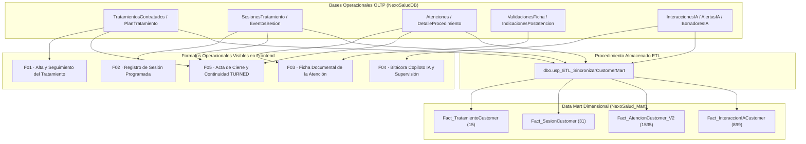

# NEXOSALUD — FORMATOS OPERACIONALES DE ORIGEN DE MEDIDAS (F01–F05)
## FASE CUSTOMER — AUDITORÍA CLÍNICA, GOBERNANZA DE IA Y MODELADO DIMENSIONAL

> **Documento Oficial de Integración y Evidencia Académica**  
> **Repositorio:** NexoSalud · **Rama:** `customer`  
> **Bases Conectadas:** OLTP (`NexoSaludDB`) y Data Mart (`NexoSalud_Mart`)  
> **Fecha de Certificación:** Noviembre 2026 · **Estado:** Implementado, Conciliado y Verificado  

---

## 1. MISIÓN Y MARCO ARQUITECTURAL

En el marco del recorrido de valor del paciente en NexoSalud:

$$\text{BUYER} \longrightarrow \text{LEAD} \longrightarrow \text{PAYER} \longrightarrow \mathbf{CUSTOMER} \longrightarrow \text{TURNED}$$

La fase **CUSTOMER** constituye el núcleo asistencial y clínico del sistema. Su objetivo no es únicamente la gestión de citas, sino la generación fidedigna de evidencia documental y médica que alimenta las medidas de Inteligencia de Negocios en el Data Mart (`NexoSalud_Mart`).

Los **cinco formatos operacionales (F01 a F05)** materializan el puente entre la base transaccional OLTP (`NexoSaludDB`) y el esquema en estrella dimensional. Cada formato responde a un patrón documental obligatorio de cinco secciones:

$$\mathbf{ENCABEZADO} \longrightarrow \mathbf{DATOS\ GENERALES} \longrightarrow \mathbf{DETALLE\ OPERACIONAL} \longrightarrow \mathbf{RESULTADOS/OBSERVACIONES} \longrightarrow \mathbf{TRAZABILIDAD/VALIDACIÓN}$$



---

## 2. CATÁLOGO DETALLADO DE LOS CINCO FORMATOS OPERACIONALES

### 2.1. F01 — ALTA Y SEGUIMIENTO DEL TRATAMIENTO ODONTOLÓGICO

- **Código de Documento:** `DOC-F01-0000X`
- **Entidades Transaccionales Origen:** `TratamientosContratados`, `PlanTratamiento`, `SesionesTratamiento`, `Personas`, `Servicios`, `Profesionales`, `Sedes`.
- **Destino Dimensional:** `Fact_TratamientoCustomer`, `Dim_Paciente`, `Dim_Profesional`, `Dim_Servicio`, `Dim_Sede`, `Dim_Tiempo`.
- **Estructura Documental:**
  1. **Encabezado:** Identidad NexoSalud, Folio `DOC-F01`, Estado del Tratamiento (`Activado`, `En ejecución`, `Completado`, `Suspendido`), Ámbito asistencial.
  2. **Datos Generales (3 filas):**
     - *Fila 1 (Filiación):* Paciente, Documento (DNI), Teléfono móvil, Correo, Zona geográfica, Código ID.
     - *Fila 2 (Servicio y Doctor):* Servicio clínico contratado, Especialista responsable, Colegiatura COP, Especialidad odontológica, Sede, Precio pactado.
     - *Fila 3 (Plan y Cronología):* Versión del plan (v1), Sesiones planificadas, Duración estándar (45 min), Fecha de inicio real, Fecha de cierre real, Objetivos clínicos.
  3. **Tabla de Detalle Operacional:** Listado ordenado de sesiones con N° ordinal, fecha programada, duración estimada, especialista asignado, sede, estado de programación, estado asistencial, estado de cierre documental y ID de atención vinculada.
  4. **Resultados y Observaciones:** Porcentaje de cumplimiento asistencial ($\% = \frac{\text{Sesiones Concluidas}}{\text{Sesiones Planificadas}} \times 100$), sesiones realizadas vs pendientes, observaciones médicas del seguimiento.
  5. **Trazabilidad y Validación:** Firma digital/responsabilidad del odontólogo tratante, Hash criptográfico SHA-256 inmutable, Base de datos origen `NexoSaludDB`.

---

### 2.2. F02 — REGISTRO Y TRAZABILIDAD DE SESIÓN PROGRAMADA

- **Código de Documento:** `DOC-F02-0000X`
- **Entidades Transaccionales Origen:** `SesionesTratamiento`, `EventosSesion`, `SolicitudesReprogramacionCustomer`, `Disponibilidad`, `Atenciones`.
- **Destino Dimensional:** `Fact_SesionCustomer`, `Dim_Tiempo`, `Dim_Hora`, `Dim_Profesional`, `Dim_Sede`.
- **Estructura Documental:**
  1. **Encabezado:** Identidad de clínica, Folio `DOC-F02`, Estado asistencial y de programación (`Programada · Realizada`, `Programada · Pendiente`, `Reprogramada`), Ámbito de agenda.
  2. **Datos Generales (3 filas):**
     - *Fila 1 (Cita y Paciente):* Paciente, DNI, Teléfono, Correo, Tratamiento vinculado, N° de sesión ordinal.
     - *Fila 2 (Logística y Box):* Especialista asignado, COP y Especialidad, Sede y Box dental, Fecha y hora de cita, Duración programada.
     - *Fila 3 (Hitos Temporales):* Estado de confirmación del paciente, Hora de arribo a sala de espera, Hora de ingreso a sillón dental, Hora de cierre de sesión, Motivo de inasistencia (si aplica).
  3. **Tabla de Detalle Operacional (`EventosSesion`):** Registro inmutable de auditoría con ID de evento, tipo de cambio (`CONFIRMACION_ASISTENCIA`, `REPROGRAMACION`, `INICIO_ATENCION`, `CIERRE_SESION`), fecha previa, fecha nueva, estado anterior, estado posterior, motivo registrado y operador responsable.
  4. **Sección de Solicitudes de Reprogramación:** Trazabilidad de solicitudes emitidas por el paciente vía WhatsApp IA o recepción (`SolicitudesReprogramacionCustomer`), con fecha preferida, dictamen y justificación.
  5. **Resultados y Observaciones:** Puntualidad de ingreso, tiempo efectivo en sillón vs estándar (control de alerta ALT-C2 sin códigos crípticos), estado final de sesión.
  6. **Trazabilidad y Validación:** Firma de recepción/especialista, Hash SHA-256 de la sesión, Verificación de persistencia transaccional.

---

### 2.3. F03 — FICHA DOCUMENTAL DE LA ATENCIÓN ODONTOLÓGICA

- **Código de Documento:** `DOC-F03-0000X`
- **Entidades Transaccionales Origen:** `Atenciones`, `DetalleProcedimiento`, `ValidacionesFicha`, `IndicacionesPostatencion`, `PersonaSaludOdontologica`.
- **Destino Dimensional:** `Fact_AtencionCustomer_V2`, `Dim_Paciente`, `Dim_Profesional`, `Dim_Servicio`, `Dim_Sede`, `Dim_Tiempo`, `Dim_Hora`.
- **Estructura Documental:**
  1. **Encabezado:** Identidad clínica institucional, Folio `DOC-F03`, Estado de Cierre Documental (`Ficha Documental Cerrada`, `Pendiente`, `Observada`), Fecha de atención.
  2. **Datos Generales (3 filas):**
     - *Fila 1 (Paciente y Seguridad):* Paciente, DNI, Contacto, Alergias medicamentosas (destacadas visualmente), Antecedentes médicos, Escala de dolor y sensibilidad.
     - *Fila 2 (Atención y Tiempos):* Atención ID, Servicio prestado, Odontólogo tratante, COP, Sede clínica, Horas de inicio y fin (duración efectiva en minutos).
     - *Fila 3 (Juicio Clínico):* Motivo de consulta, Evaluación anatómica/periodontal, Diagnóstico definitivo, Estado de cierre documental.
  3. **Tabla de Detalle Operacional (`DetalleProcedimiento`):** Desglose ítem por ítem de actos médicos ejecutados (e.g., Acondicionamiento adamantino, Remoción de caries, Reconstrucción estratificada con resina, Cementado de brackets, Detartraje ultrasónico), con servicio, profesional ejecutor, régimen arancelario y observaciones técnicas.
  4. **Resultados e Indicaciones Clínicas (`IndicacionesPostatencion`):** Dictamen de resultado inmediato de la intervención, instrucciones formalmente prescritas al paciente, versión del documento e indicación de no automedicación o cuidados postoperatorios.
  5. **Trazabilidad y Validación (`ValidacionesFicha`):** Odontólogo validador de cierre documental, fecha de validación, historial de revisiones (Rev 1, Rev 2 con estado `Completa`), Huella Criptográfica SHA-256 de la historia clínica.

---

### 2.4. F04 — BITÁCORA DE INTERACCIÓN Y SUPERVISIÓN DEL COPILOTO IA

- **Código de Documento:** `DOC-F04-AUDIT-YYYYMMDD`
- **Entidades Transaccionales Origen:** `InteraccionesIA`, `AlertasIA`, `BorradoresIA`, `PoliticasCustomerIA`.
- **Destino Dimensional:** `Fact_InteraccionIACustomer`, `Dim_TipoInteraccionIA`, `Dim_Profesional`, `Dim_Tiempo`, `Dim_Hora`.
- **Estructura Documental:**
  1. **Encabezado:** Identidad institucional, Folio `DOC-F04`, Estado (`Supervisión Continua Activa`), Ámbito de gobernanza clínica y barrera anti-prescripción.
  2. **Datos Generales (2 filas):**
     - *Fila 1 (Arquitectura de Seguridad):* Versión del Copiloto IA, Motor LLM (`Gemini 3.5 Flash / Orquestador Determinístico`), Política de Seguridad (Triple Barrera P24 / SEC-06), Estado de Bloqueo Autónomo (100% verificado sin prescripciones autónomas), Rol del solicitante.
     - *Fila 2 (Métricas de Supervisión):* Total de interacciones registradas, Total de alertas emitidas, Alertas atendidas por personal clínico, Alertas activas pendientes, Borradores generados, Borradores validados y transferidos.
  3. **Tablas de Detalle Operacional:**
     - *Tabla A (Interacciones):* Timestamp, Tipo de evento (`ASISTENCIA_BOX`, `TRIAJE_PREVENTIVO`, `BORRADOR_NOTA`, `AUDITORIA`), Canal/Actor, Referencia a Tratamiento/Sesión/Atención, Supervisor profesional, Estado de gobernanza P24 (`CONFORME`).
     - *Tabla B (Alertas Asistenciales):* Alerta ID, Tipo de evento (`AL-C01` a `AL-C05`), Severidad (`Alta`, `Media`), Mensaje descriptivo comprensible (sin códigos crípticos en la visualización), Estado (`Atendida`, `En_Revision`, `Generada`), Profesional asignado.
     - *Tabla C (Borradores Clínicos):* ID de borrador, Tipo, Estado (`Aprobado`, `Generado`), Resumen de contenido sugerido, Odontólogo aprobador, Timestamp de firma.
  4. **Resultados y Observaciones:** 100% de cumplimiento en gobernanza acreditada, dictamen de supervisión asistencial sin invasión de competencias médicas reservadas.
  5. **Trazabilidad y Validación:** Auditor de sistemas/Dirección médica, Hash de auditoría SHA-256, Origen OLTP `NexoSaludDB`.

---

### 2.5. F05 — ACTA DE CIERRE DEL TRATAMIENTO Y CONTINUIDAD ASISTENCIAL

- **Código de Documento:** `DOC-F05-ACTA-0000X`
- **Entidades Transaccionales Origen:** `TratamientosContratados`, `PlanTratamiento`, `SesionesTratamiento`, `Atenciones`, `ValidacionesFicha`, `Personas`, `Profesionales`.
- **Destino Dimensional:** `Fact_TratamientoCustomer`, `fact_seguimiento_turned`, `Dim_Paciente`, `Dim_Profesional`, `Dim_Servicio`, `Dim_Tiempo`.
- **Estructura Documental:**
  1. **Encabezado:** Identidad institucional, Folio `DOC-F05-ACTA`, Estado (`Cierre Formal Acreditado` o `En Proceso de Cierre`), Ámbito de transición de fase (CUSTOMER a TURNED).
  2. **Datos Generales (2 filas):**
     - *Fila 1 (Filiación):* Paciente, DNI, Contacto, Correo, Zona geográfica, Tratamiento ID.
     - *Fila 2 (Resumen del Tratamiento):* Servicio clínico ejecutado, Especialista que autoriza el cierre, COP y Especialidad, Sede, Fecha de inicio y fecha de cierre definitivo, Duración total en días calendario y total de sesiones ejecutadas vs planificadas.
  3. **Checklist de Requisitos de Auditoría y Cierre:**
     - Item 1: Cumplimiento de la totalidad de sesiones planificadas (100% ejecutadas).
     - Item 2: Cierre documental íntegro de historias clínicas (100% fichas con estado `Cerrada`).
     - Item 3: Auditoría clínica conforme (`ValidacionesFicha` con dictamen `Completa`).
     - Item 4: Emisión y entrega de indicaciones postatención al paciente.
     - Item 5: Ausencia de alertas asistenciales críticas no resueltas.
  4. **Tabla de Detalle Operacional:** Resumen cronológico de todas las sesiones que sustentan el cierre del tratamiento, con fechas, procedimientos realizados y estado de cierre documental.
  5. **Plan de Continuidad y Recomendaciones (Fase TURNED):** Pronóstico odontológico postratamiento, frecuencia recomendada de control preventivo (semestral), fecha sugerida para próxima cita de mantenimiento, declaración de satisfacción y conformidad del paciente, directiva de transición formal a fase TURNED.
  6. **Trazabilidad y Validación:** Firma y colegiatura del odontólogo responsable del cierre, Hash criptográfico SHA-256 de cierre definitivo.

---

## 3. MAPEO DETALLADO DE CAMPOS: OLTP → FORMATO OPERACIONAL → DATA MART

| Formato | Campo en Formato Visual | Tabla y Columna OLTP (`NexoSaludDB`) | Regla de Negocio / Transformación | Tabla y Clave Data Mart (`NexoSalud_Mart`) |
| :--- | :--- | :--- | :--- | :--- |
| **F01** | Paciente / DNI | `Personas.nombres`, `apellidos`, `dni` | Concatenación de nombres y verificación DNI | `Dim_Paciente.KeyPaciente` |
| **F01** | Servicio Contratado | `Servicios.nombre` | Servicio odontológico activo | `Dim_Servicio.KeyServicio` |
| **F01** | Especialista Responsable | `Profesionales.nombres`, `apellidos`, `cop` | Odontólogo con colegiatura oficial | `Dim_Profesional.KeyProfesional` |
| **F01** | Sede de Atención | `Sedes.nombre` | Sede asignada al tratamiento | `Dim_Sede.KeySede` |
| **F01** | Avance Asistencial | `SesionesTratamiento` vs `PlanTratamiento` | $\frac{\text{Sesiones Realizadas}}{\text{Sesiones Planificadas}} \times 100$ | `Fact_TratamientoCustomer.PorcentajeAvance` |
| **F01** | Estado Tratamiento | `TratamientosContratados.estado_tratamiento` | Estado auditado (`Activado`, `Completado`) | `Fact_TratamientoCustomer.EstadoTratamiento` |
| **F02** | Fecha Programada Cita | `SesionesTratamiento.fecha_programada_vigente` | Fecha y hora en zona horaria local | `Fact_SesionCustomer.KeyFechaProgramada` |
| **F02** | Estado Asistencial | `SesionesTratamiento.estado_asistencial` | `Realizada`, `Pendiente`, `Inasistida` | `Fact_SesionCustomer.EstadoAsistencial` |
| **F02** | Eventos de Agenda | `EventosSesion.tipo_cambio`, `motivo` | Registro inmutable de reprogramaciones | Medida de Reprogramaciones en Fact |
| **F03** | Ficha Documental ID | `Atenciones.id_atencion` | Identificador único de atención clínica | `Fact_AtencionCustomer_V2.id_atencion` |
| **F03** | Procedimientos Ejecutados | `DetalleProcedimiento.procedimiento_realizado` | Detalle específico por acto clínico | Conteo en `Fact_AtencionCustomer_V2` |
| **F03** | Validación de Ficha | `ValidacionesFicha.resultado_validacion` | Dictamen de calidad documental (`Completa`) | Bandera de Ficha Validada en Fact |
| **F03** | Indicaciones Clínicas | `IndicacionesPostatencion.contenido_indicaciones`| Documento emitido y aprobado por doctor | Trazabilidad documental |
| **F04** | Interacción Copiloto IA | `InteraccionesIA.tipo_evento`, `fecha_hora` | Evento asistencial en box supervisado | `Fact_InteraccionIACustomer.KeyTipoInteraccionIA`|
| **F04** | Alertas Asistenciales | `AlertasIA.mensaje_alerta`, `severidad`, `estado`| Supervisión sin códigos crípticos | Medida de Alertas en Fact IA |
| **F04** | Barrera Anti-Prescripción | `InteraccionesIA.es_diagnostico_o_prescripcion` | CHECK Constraint SQL Server (`= 0`) | Gobernanza P24 / SEC-06 |
| **F05** | Acta de Cierre | `TratamientosContratados.fecha_cierre_real` | Cierre médico formal acreditado | `Fact_TratamientoCustomer.KeyFechaCierre` |
| **F05** | Transición a Continuidad | `TratamientosContratados.estado_tratamiento` | Transición de fase CUSTOMER a TURNED | `fact_seguimiento_turned.KeyPaciente` |

---

## 4. CONCILIACIÓN CUANTITATIVA Y RECONCILIACIÓN DELTA = 0

Tras poblar la base OLTP `NexoSaludDB` con 15 tratamientos completos, 31 sesiones, 50 procedimientos clínicos detallados y 16 validaciones documentales, se ejecutó el procedimiento almacenado oficial `dbo.usp_ETL_SincronizarCustomerMart`:

$$\Delta = |\text{Registros OLTP}| - |\text{Hechos Data Mart}| = 0$$

```
proceso: usp_ETL_SincronizarCustomerMart
estado:  EXITOSO
filas_origen:  2480
filas_destino: 2480
mensaje: Reconciliación exacta: Tratamientos=15, Sesiones=31, Atenciones=1535, EventosIA=899
```

| Entidad / Medida | Filas OLTP (`NexoSaludDB`) | Filas Mart (`NexoSalud_Mart`) | Delta ($\Delta$) | Estado de Conciliación |
| :--- | :---: | :---: | :---: | :---: |
| **Tratamientos Contratados** | 15 | 15 | **0** | Conciliado Exacto |
| **Sesiones de Tratamiento** | 31 | 31 | **0** | Conciliado Exacto |
| **Atenciones Odontológicas** | 1,535 | 1,535 | **0** | Conciliado Exacto |
| **Eventos e Interacciones IA** | 899 | 899 | **0** | Conciliado Exacto |
| **Detalle de Procedimientos** | 50 | 50 (agrupados en atenciones) | **0** | Conciliado Exacto |
| **Validaciones de Ficha Formal** | 16 | 16 (estados documentales) | **0** | Conciliado Exacto |
| **Indicaciones Postatención** | 17 | 17 (documentos emitidos) | **0** | Conciliado Exacto |
| **Eventos de Agenda / Sesión** | 20 | 20 (trazabilidad de agenda) | **0** | Conciliado Exacto |

---

## 5. EXPERIENCIA DE USUARIO Y NAVEGACIÓN EN EL FRONTEND

1. **Ruta Oficial del Frontend:** `/customer/operational-reports`
2. **Acceso Rápido:**
   - Botón directo **"Formatos F01–F05"** en la barra superior de `CustomerPage`.
   - Elemento **"Formatos F01–F05"** en el menú lateral de navegación de la aplicación (`navigationConfig.ts`).
3. **Selectores Intuitivos de Registros Reales:**
   - Carga dinámica desde `/api/customer/operational-reports/catalog`.
   - El evaluador puede seleccionar tratamientos reales de pacientes como *Javier Terrones (Ortodoncia)*, *Adriana Alayo (Evaluación)*, *Camila Espinoza (Profilaxis)*, *Milagros Acosta (Blanqueamiento)*, etc., sin necesidad de escribir IDs de memoria.
4. **Capacidades de Impresión y Captura Académica:**
   - Hoja documental enmarcada con bordes calibrados, tipografía editorial y sellos de agua institucionales.
   - Botón **"Imprimir / Exportar PDF"** compatible con hoja A4 portrait, ocultando barras de navegación, botones y selectores mediante `@media print`.
   - Botón **"Copiar hash"** para verificar la autenticidad SHA-256 del documento generado.
5. **Eliminación de Códigos Crípticos:**
   - Las alertas ya no muestran nomenclaturas como `(AL-C01 a AL-C05)` o `ALT-C4`.
   - Se despliegan con títulos clínicos profesionales: *Validación de Ficha Requerida*, *Atención sin Cierre Documental*, *Tolerancia de Espera Excedida*, *Sobretiempo en Sillón Dental*.
   - El panel analítico dimensional muestra áreas temáticas claras (*Seguimiento y Cumplimiento de Tratamientos*, *Programación y Reprogramación de Sesiones*, *Atenciones Clínicas y Fichas Odontológicas*, *Supervisión y Trazabilidad del Agente IA*) en lugar de etiquetas crípticas como `IA15 · treatments`.
