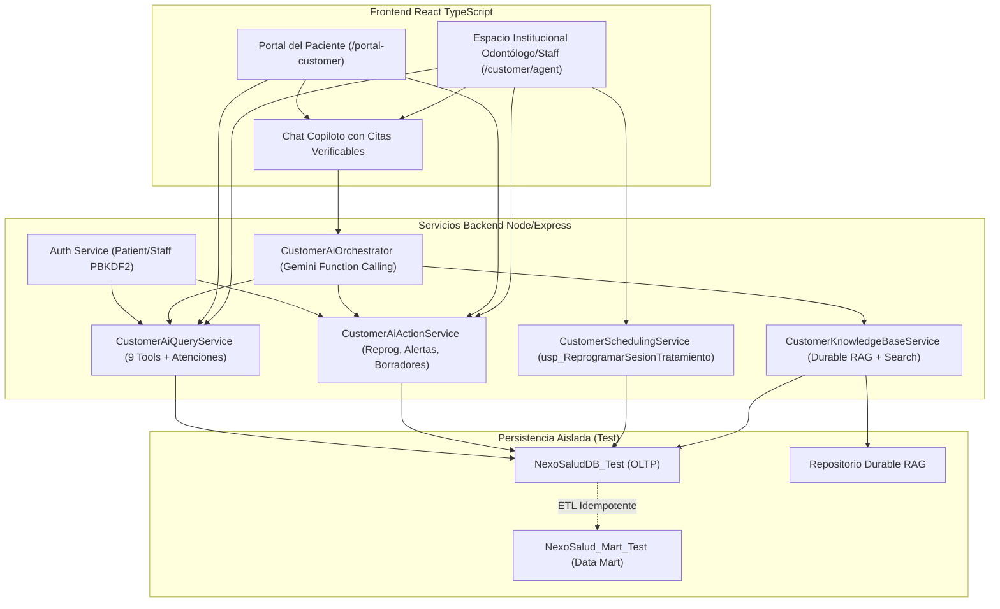

# CIERRE 00 — Auditoría General y Diagnóstico Inicial del Agente Inteligente CUSTOMER (Pasos 1 al 6)

**Fecha:** 2026-11-10  
**Rama activa:** `customer`  
**Commit base:** `11f730b` (Implementa agente clínico con Gemini y acciones supervisadas)  
**Objetivo:** Diagnóstico exhaustivo del estado técnico, código fuente, base de datos y esquemas de los pasos 1 a 6 previo a la ejecución y certificación definitiva.

---

## 1. Estado de Git y Entorno

- **Rama:** `customer` (alineada con commits previos de fases BUYER, LEAD, PAYER y avances CUSTOMER).
- **Commit HEAD:** `11f730b`.
- **Estado de cambios de trabajo:**
  - Archivos modificados: `backend/package.json`, `backend/scripts/seed-customer-ai-test-data.sql`, `backend/tests/customerAiPersistence.test.ts`, `docs/customer/ai-agent/PASO_04_1_CERTIFICACION_INTEGRAL.md`, componentes y rutas de frontend.
  - Archivos no rastreados: `backend/src/modules/customer/knowledge-base/`, `backend/tests/customerKnowledgeBase.test.ts`, `docs/customer/ai-agent/PASO_05_RAG_CONOCIMIENTO.md`, `docs/customer/ai-agent/PASO_06_FRONTEND_INTEGRACION.md`, y páginas/servicios del frontend CUSTOMER.
  - Preservación: No se ejecutaron operaciones destructivas (`reset --hard`, `clean`). Todo el trabajo previo se conserva íntegro.

---

## 2. Auditoría de Seguridad de Bases de Datos

Se realizó una verificación de seguridad con `sys.databases` y credenciales de motor:
- Instancia activa: `JEAC` (localhost:1433).
- Bases existentes:
  - `NexoSaludDB`: Base OLTP operativa con datos históricos (805 captaciones, 124 reservas/pagos).
  - `NexoSalud_Mart`: Data Mart dimensional operativo.
  - `NexoSaludDB_Test`: Base de pruebas aislada creada para la certificación.
  - `NexoSalud_Mart_Test`: Data Mart de pruebas aislado creado para la certificación.
- Auditoría de escrituras históricas en `NexoSaludDB`:
  - Se identificaron registros en `dbo.InteraccionesIA` (43), `dbo.AlertasIA` (35), `dbo.BorradoresIA` (49) creados el 2026-11-10 entre 18:56 y 20:34 producto de corridas preliminares de tests antes de activar guardias de aislamiento.
  - Se confirma la regla de seguridad: **NO se borran estos registros operativos**. Permanecen documentados.
  - En `NexoSaludDB_Test`, las tablas de IA (`InteraccionesIA`, `AlertasIA`, `BorradoresIA`, `SolicitudesReprogramacionCustomer`) tienen 0 registros.
- Login de integración de mínimo privilegio:
  - Se identificó el login `NexoSaludCustomerTest`, el cual **no es sysadmin** (`sysadmin = 0`), no tiene usuario ni permisos en `NexoSaludDB` ni `NexoSalud_Mart`, y posee únicamente roles `db_datareader`, `db_datawriter`, `db_ddladmin` y permisos de ejecución en `NexoSaludDB_Test` y `NexoSalud_Mart_Test`.

---

## 3. Matriz de Auditoría por Paso (Pasos 1 al 6)

| Paso | Funcionalidad | Implementación encontrada | Evidencia | Problema | Acción necesaria |
|---|---|---|---|---|---|
| **Paso 1** | Infraestructura y persistencia del Agente IA | Tablas `InteraccionesIA`, `AlertasIA`, `BorradoresIA` creadas. Migración Prisma `20261110161000`. `CustomerAiPersistenceService` con auditoría y métricas. | `schema.prisma`, `backend/src/services/customerAiPersistenceService.ts`. DDL en SQL Server. | La suite `customerAiPersistence.test.ts` dependía de datos existentes en la BD operativa y carecía de guardias de seguridad; fue temporalmente omitida. | Implementar fixture sintético autónomo en `NexoSaludDB_Test` y certificar persistencia, métricas y restricciones CHECK con usuario no-sysadmin. |
| **Paso 2** | Backend y herramientas deterministas | 9 herramientas de consulta (`getPatientTreatments`, `getUpcomingSessions`, `getTreatmentProgress`, `getApprovedAftercareInstructions`, etc.) en `CustomerAiQueryService`. Endpoints Express con Bearer token. | `backend/src/modules/customer/ai-agent/services/customerAiQueryService.ts`, `routes.ts`, `tests/customerAiAgentSecurity.test.ts`. | Falta endpoint para que el paciente liste sus atenciones propias (`/me/attentions`) y para que el odontólogo liste atenciones asignadas (`/staff/attentions`). Sin ellos el frontend forzaba ingreso manual de `attentionId`. | Agregar endpoints autorizados `/me/attentions` y `/staff/attentions` con validación estricta de propiedad/ámbito, paginación y minimización de datos. |
| **Paso 3** | LLM y orquestación con Gemini | `GeminiCustomerAiProvider`, `CustomerAiOrchestrator`, function calling con Google Gen AI SDK v1beta, validación de esquemas y cuotas, prompt anti-inyección. | `backend/src/modules/customer/ai-agent/services/geminiProvider.ts`, `customerAiOrchestrator.ts`. | Las herramientas de conocimiento institucional RAG no estaban expuestas al orquestador; el prompt bloqueaba consultas documentales por falta de RAG persistente. | Registrar herramientas RAG autorizadas (`searchApprovedKnowledge`, `getKnowledgeDocumentReference`) en el orquestador y probar escenarios sintéticos con control de datos externos. |
| **Paso 4 / 4.1** | Acciones supervisadas y certificación integral | `CustomerAiActionService`, `CustomerSchedulingService` sobre `dbo.usp_ReprogramarSesionTratamiento`, detectores AL-C01 a AL-C05, versionado de borradores. | `routes.ts`, `customerAiActions.test.ts`, `07_validaciones_customer.sql`. | El script de validación `07_validaciones_customer.sql` fallaba por `NULL` en `EvidenciaCuantitativa` y dependía de supuestos fijos de producción (805 captaciones, 124 pagos). Matriz P01–P32 quedó parcialmente certificada (22 bloqueadas). | Corregir `07_validaciones_customer.sql`, generar fixture sintético autónomo, ejecutar flujo completo de reprogramación, alertas, borradores y ETL en `_Test`, certificando las 32 pruebas. |
| **Paso 5** | Base de conocimiento y RAG local | `LocalKnowledgeBase` en memoria con BM25 simplificado, tokenización y filtrado por roles. | `backend/src/modules/customer/knowledge-base/knowledgeBase.ts`, `tests/customerKnowledgeBase.test.ts`. | Solo residía en memoria volátil; sin persistencia en BD, sin API de ingesta administrativa autenticada, sin soporte de DOCX/PDF extraíble, sin citas verificables integradas al chat. | Diseñar capa de persistencia durable para documentos, versiones y fragmentos; API de ingesta con firma/autorización; parser seguro de texto/MD/DOCX/PDF; citación verificable y evaluación P01–P32. |
| **Paso 6** | Frontend React del paciente y odontólogo/personal | `CustomerPatientPortalPage.tsx`, `CustomerAiStaffWorkspacePage.tsx`, `customerAiAgentApi.ts`, rutas `/portal-customer` y `/customer/agent`. | `frontend/src/modules/customer/`, Vite build exitoso, tests unitarios de cliente API. | UI requería ingreso manual de IDs de atención por falta de endpoints backend; falta selector de disponibilidad en recepción; RAG no reflejaba citas en chat; falta validación F01–F30. | Conectar selectores reactivos con nuevos endpoints, integrar visualización de citas RAG en chat, selector de disponibilidad de agenda y ejecutar matriz F01–F30. |

---

## 4. Mapa de Dependencias Críticas

---

## 5. Plan de Acción Inmediato

1. **FASE B:** Configurar credenciales y rotar password de `NexoSaludCustomerTest`, verificar entorno `_Test` y construir el generador de fixture sintético autónomo (`seed-customer-ai-autonomous.sql` o script TypeScript) que no use IDs fijos.
2. **FASE C:** Revalidar Pasos 1 y 2, incorporando los endpoints `/me/attenciones` y `/staff/attenciones` y ejecutando tests de persistencia y consultas.
3. **FASE D:** Revalidar Paso 3 (orquestador Gemini), integrando las herramientas RAG.
4. **FASE E:** Corregir el harness SQL `07_validaciones_customer.sql` y ejecutar la matriz P01–P32 completa del Paso 4.1.
5. **FASE F:** Implementar persistencia durable RAG, ingesta autenticada, citas verificables y matriz P01–P32 del Paso 5.
6. **FASE G:** Completar frontend React (selectores de atención, disponibilidad, citas RAG en chat) y matriz F01–F30 del Paso 6.
7. **FASE H & I:** Pruebas E2E (E2E-01 a E2E-10), conciliación dimensional y regresión financiera PAYER.
8. **FASE J:** Documentación integral en `CIERRE_INTEGRAL_PASOS_01_A_06.md`.
