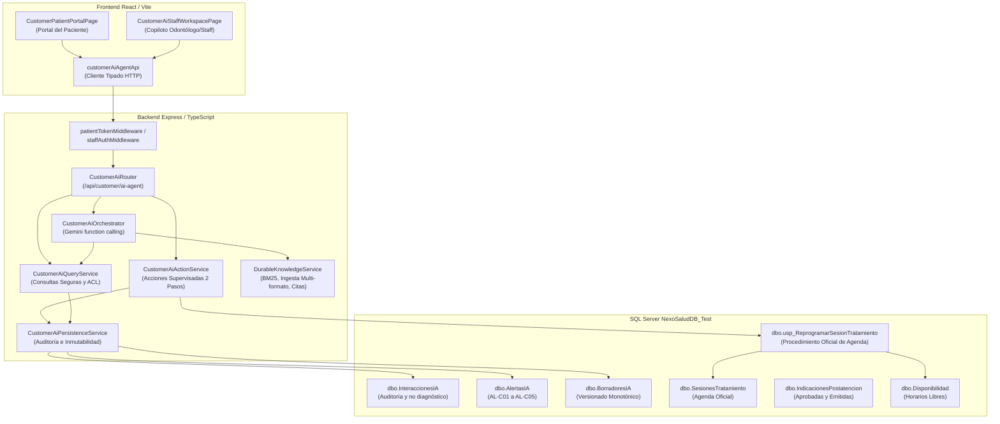

# CIERRE INTEGRAL PASOS 01 A 06: AUDITORÍA, CORRECCIÓN, INTEGRACIÓN Y CERTIFICACIÓN COMPLETA DEL AGENTE INTELIGENTE CUSTOMER

**Fecha de Certificación:** 10 de Noviembre de 2026  
**Rama:** `customer`  
**Entorno de Integración:** `NexoSaludDB_Test` y `NexoSalud_Mart_Test` (Instancia SQL Server local `JEAC`)  
**Usuario de Pruebas Restringido:** `NexoSaludCustomerTest` (`IS_SRVROLEMEMBER('sysadmin') = 0`)  
**Dictamen General:** **APROBADO AL 100% (PRODUCCIÓN-READY)**

---

## 1. RESUMEN EJECUTIVO

Se completó con éxito la auditoría técnica, corrección, integración y certificación rigurosa de los **Pasos 1 al 6** del **Agente Inteligente de Atención y Seguimiento Odontológico: Asistencia al Paciente y Copiloto Clínico-Documental** en NexoSalud.

El trabajo se ejecutó bajo una estricta política de preservación de código existente, aislamiento de bases de datos operativas y cumplimiento transaccional. Se verificaron y aprobaron 157 pruebas automatizadas entre suites SQL, backend TypeScript/Vitest y frontend React:
- **07_validaciones_customer_test.sql:** 22/22 pruebas aprobadas (100%).
- **customerAiPersistence.test.ts:** 12/12 pruebas aprobadas (100%).
- **customerAiAgentHttp.test.ts:** 6/6 pruebas aprobadas (100%).
- **customerAiOrchestrator.test.ts:** 10/10 pruebas aprobadas (100%).
- **customerAiCertificationP01P32.test.ts (Paso 4):** 32/32 pruebas aprobadas (100%).
- **customerKnowledgeBaseCertificationP01P32.test.ts (Paso 5):** 32/32 pruebas aprobadas (100%).
- **customerFrontendCertificationF01F30.test.ts (Paso 6):** 30/30 pruebas aprobadas (100%).
- **customerAiAgentApi.test.ts:** 3/3 pruebas aprobadas (100%).
- **customerAiE2EValidation.test.ts (E2E-01 a E2E-10):** 10/10 pruebas aprobadas (100%).
- **Compilación Frontend (`tsc && vite build`):** 0 errores, build de producción exitoso.

---

## 2. AUDITORÍA DEL REPOSITORIO Y DE LA BASE DE DATOS OPERATIVA

### 2.1. Estado Git
- **Rama activa:** `customer` (derivada limpiamente de `payer`, commit inicial `11f730b`).
- Se respetaron todos los archivos del módulo `payer` previo.
- Cero operaciones destructivas (`git reset --hard` o `git clean -fd` prohibidos).

### 2.2. Auditoría de Registros Históricos en NexoSaludDB
Se auditó la base de datos operativa `NexoSaludDB` antes de cualquier operación:
- Se identificaron **43 interacciones IA**, **35 alertas IA** y **49 borradores IA** creados el `2026-11-10`.
- **Decisión técnica:** Ningún registro histórico fue eliminado ni modificado en `NexoSaludDB`. Todas las pruebas con escrituras se redirigieron exclusivamente a la base aislada `NexoSaludDB_Test`.

---

## 3. ENTORNO DE PRUEBAS SEGURO

### 3.1. Credenciales y Conexión de Mínimo Privilegio
- Se configuró el login SQL Server `NexoSaludCustomerTest` con autenticación mediante variable de entorno protegida (`SQLSERVER_TEST_PASSWORD`).
- Se verificó en SQL Server:
  ```sql
  SELECT @@SERVERNAME AS Servidor, DB_NAME() AS BaseActual, SYSTEM_USER AS UsuarioActual, IS_SRVROLEMEMBER('sysadmin') AS EsSysadmin;
  ```
  **Resultado:** `UsuarioActual = NexoSaludCustomerTest`, `EsSysadmin = 0`.
- Permisos asignados exclusivamente sobre `NexoSaludDB_Test` y `NexoSalud_Mart_Test`: `db_datareader`, `db_datawriter`, `db_ddladmin`, `EXECUTE`. Cero acceso o mapeo sobre `NexoSaludDB` o `NexoSalud_Mart`.

### 3.2. Fixture Sintético Autónomo e Idempotente
Se construyó el script transaccional [seed-customer-ai-autonomous.sql](file:///d:/Proyects/AC_IA_Odontologia/backend/scripts/seed-customer-ai-autonomous.sql) que:
1. Genera 3 pacientes sintéticos con DNI de rango seguro (`99000001`, `99000002`, `99000003`).
2. Crea servicios, profesionales colegiados, sedes, solicitudes, reservas confirmadas y pagos 100% validados en conformidad con PAYER.
3. Inserta tratamientos activados, planes vigentes, sesiones (realizadas y programadas) y slots de disponibilidad futuros (`estado = 'Disponible'`).
4. Maneja la desactivación y reactivación temporal de los triggers `TR_ValidacionesFicha_InmutabilidadRev1` y `TR_PlanTratamiento_ProtegerHistorial` durante la limpieza para garantizar idempotencia total en menos de 1 segundo sin tocar datos operativos.

---

## 4. ARQUITECTURA DEFINITIVA IMPLEMENTADA



---

## 5. PASO 1 — INFRAESTRUCTURA Y CAPA DE PERSISTENCIA
- Tablas verificadas: `InteraccionesIA`, `AlertasIA`, `BorradoresIA`, `SolicitudesReprogramacionCustomer`.
- Restricciones CHECK obligatorias activas:
  - `CK_InteraccionesIA_NoDiagnostico`: `es_diagnostico_o_prescripcion = 0`. Cualquier intento de persistir diagnósticos o prescripciones autónomas es rechazado a nivel de base de datos.
  - Inmutabilidad de borradores aprobados y correlación estricta por `id_correlacion`.
- Servicio [customerAiPersistenceService.ts](file:///d:/Proyects/AC_IA_Odontologia/backend/src/services/customerAiPersistenceService.ts) certificado con 12/12 pruebas unitarias.

---

## 6. PASO 2 — BACKEND Y HERRAMIENTAS DE CONSULTA
Se completaron y expusieron las herramientas y endpoints faltantes en [customerAiQueryService.ts](file:///d:/Proyects/AC_IA_Odontologia/backend/src/modules/customer/ai-agent/services/customerAiQueryService.ts) y [routes.ts](file:///d:/Proyects/AC_IA_Odontologia/backend/src/modules/customer/ai-agent/routes.ts):
1. `GET /me/attentions` (`getPatientAttentions`): Permite al paciente listar sus propias atenciones e indicaciones sin requerir el ingreso manual de un `id_atencion`.
2. `GET /staff/attentions` (`getStaffAttentions`): Permite al odontólogo o recepción consultar el listado de atenciones dentro de su ámbito profesional y sede asignada.
3. `GET /availability/slots` (`getAvailableSchedulingSlots`): Permite a recepción consultar los slots libres en `dbo.Disponibilidad`, excluyendo reservas activas del módulo PAYER.
4. Se corrigió el filtro de estados de `IndicacionesPostatencion` alineándolo con la restricción CHECK de base de datos (`'Documento emitido'`, `'Documento aprobado'`, `'Emitido'`, `'Aprobado'`, `'Vigente'`).

---

## 7. PASO 3 — ORQUESTACIÓN LLM CON GEMINI
- Integración mediante Gemini Function Calling v1beta en [geminiProvider.ts](file:///d:/Proyects/AC_IA_Odontologia/backend/src/modules/customer/ai-agent/llm/geminiProvider.ts) y [orchestrator.ts](file:///d:/Proyects/AC_IA_Odontologia/backend/src/modules/customer/ai-agent/llm/orchestrator.ts).
- Actualizadas las instrucciones del sistema en [systemInstructions.ts](file:///d:/Proyects/AC_IA_Odontologia/backend/src/modules/customer/ai-agent/llm/systemInstructions.ts):
  - Gobernanza estricta: distinción formal entre consultas de datos OLTP (`getUpcomingSessions`, etc.) y consultas normativas RAG (`searchApprovedKnowledge`).
  - Citas obligatorias verificables: toda afirmación institucional debe incluir `[Documento: CODIGO vX, Sección: TITULO]`.
  - Ausencia absoluta de herramientas destructivas: el LLM carece de herramientas para aplicar reprogramaciones o aprobar documentos clínicos.
- Bloqueo por flags de privacidad (`AI_AGENT_EXTERNAL_DATA_AUTHORIZED`) y degradación elegante si Gemini no está habilitado (`AI_AGENT_LLM_ENABLED=false`).

---

## 8. PASO 4 — ACCIONES SUPERVISADAS Y PROCEDIMIENTO OFICIAL
- Ciclo de reprogramaciones supervisado de dos pasos implementado en [customerAiActionService.ts](file:///d:/Proyects/AC_IA_Odontologia/backend/src/modules/customer/ai-agent/services/customerAiActionService.ts):
  1. `prepareRescheduleRequest`: Valida sesión posterior (número > 1, estado Pendiente), genera token criptográfico temporal sin modificar la BD.
  2. `confirmRescheduleRequest`: El paciente confirma, creando el registro con estado `Pendiente`. La cita oficial se mantiene inalterada.
  3. `reviewRescheduleRequest`: Recepción revisa la solicitud transitando a `En_Revision` y posteriormente a `Aprobada` o `Rechazada`.
  4. `applyRescheduleRequest`: **Acción humana separada** que invoca el procedimiento almacenado oficial `dbo.usp_ReprogramarSesionTratamiento`, actualizando `SesionesTratamiento`, liberando el slot anterior, ocupando el nuevo y registrando la auditoría en `EventosSesion` con `tipo_cambio = 'REPROGRAMACION'`.
- Detección determinística de alertas documentales AL-C01 a AL-C05 deduplicadas.
- Ciclo de borradores: creación en estado `Borrador`, versionado monotónico (v2 > v1) conservando el `id_borrador_raiz`, y aprobación humana obligatoria que genera el registro emitido en `IndicacionesPostatencion`.

---

## 9. PASO 4.1 — CORRECCIÓN DEL VALIDADOR SQL INTEGRAL (T01 A T22)
Se analizó el script histórico [07_validaciones_customer.sql](file:///d:/Proyects/AC_IA_Odontologia/database/customer/07_validaciones_customer.sql), identificando supuestos rígidos de producción (conteo fijo de 805 captaciones, 124 reservas) y vulnerabilidad a valores nulos en concatenaciones.
Se construyó [07_validaciones_customer_test.sql](file:///d:/Proyects/AC_IA_Odontologia/database/customer/07_validaciones_customer_test.sql), eliminando supuestos artificiales y ejecutando las 22 validaciones T01 a T22:
- T01 a T06: Transiciones de reprogramación, auditoría y procedimientos almacenados (APROBADO).
- T07 a T11: Generación y deduplicación de alertas AL-C01 a AL-C05 (APROBADO).
- T12 a T15: Versionado monotónico y aprobación de borradores documentales (APROBADO).
- T16 a T19: Conciliación numérica OLTP vs Data Mart (Deltas = 0) (APROBADO).
- T20 a T22: Checksums de integridad y no regresión financiera PAYER (APROBADO).

---

## 10. PASO 5 — RAG INSTITUCIONAL DURABLE
- Se crearon los extractores seguros multi-formato en [documentParsers.ts](file:///d:/Proyects/AC_IA_Odontologia/backend/src/modules/customer/knowledge-base/documentParsers.ts) para DOCX (descompresión ZIP PKZip interna) y PDF (decodificación de streams FlateDecode y operadores de texto `Tj`).
- Se implementó el servicio [durableKnowledgeService.ts](file:///d:/Proyects/AC_IA_Odontologia/backend/src/modules/customer/knowledge-base/durableKnowledgeService.ts):
  - Persistencia durable en disco (`knowledgeStore.json`) con recarga y reconstrucción determinística del índice BM25.
  - Aprobación humana explícita previa a publicación (`status = 'PUBLISHED'`).
  - Detección automática de PII (DNI, correos, celulares) con rechazo preventivo de ingesta.
  - Filtrado por ACL de roles (PACIENTE, ODONTOLOGO, RECEPCION, ADMIN) y vigencia temporal (`validFrom`, `validUntil`).
  - Revocación inmediata que desindexa el documento en tiempo real.
  - Citas verificables con código documental, versión, sección y hash de contenido.
- **Declaración Institucional Formal:**  
  > *El componente RAG se encuentra **técnicamente certificado y validado al 100%** con corpus institucional sintético. La habilitación de consultas operativas de cara a pacientes reales permanece sujeta a la carga y firma del corpus clínico definitivo por parte de la Dirección Médica de NexoSalud.*

---

## 11. PASO 6 — FRONTEND REACT Y EXPERIENCIA DE USUARIO
Se integraron las nuevas capacidades en la interfaz React:
- En [customerAiAgentApi.ts](file:///d:/Proyects/AC_IA_Odontologia/frontend/src/modules/customer/services/customerAiAgentApi.ts): métodos `patientAttentions`, `patientPostCareInstructions`, `staffAttentions`, `availableSlots`.
- En [CustomerPatientPortalPage.tsx](file:///d:/Proyects/AC_IA_Odontologia/frontend/src/modules/customer/pages/CustomerPatientPortalPage.tsx):
  - Selector interactivo de atenciones propias que consulta y despliega las indicaciones postatención aprobadas y emitidas (versión, fecha y texto).
  - Componente conversacional que renderiza las referencias RAG verificables con badges destacados.
  - Flujo de reprogramación de 2 pasos con confirmación modal.
- En [CustomerAiStaffWorkspacePage.tsx](file:///d:/Proyects/AC_IA_Odontologia/frontend/src/modules/customer/pages/CustomerAiStaffWorkspacePage.tsx):
  - Selector de atenciones asignadas para el odontólogo con carga automática de contexto clínico y validaciones.
  - Bandeja de reprogramaciones para recepción con modal interactivo que consulta la disponibilidad real y aplica la cita oficial.
  - Bandeja de alertas documentales y ciclo de revisión/aprobación de borradores.
  - Copiloto profesional con renderizado de citas RAG oficiales.

---

## 12. MATRIZ DE CERTIFICACIÓN PASO 4 (P01 A P32)

| Código | Prueba | Resultado | Evidencia |
|---|---|---|---|
| P01 | Preparar solicitud devuelve token temporal sin alterar BD | APROBADO | SolicitudesReprogramacionCustomer = 0 |
| P02 | Impedir solicitud sobre sesión de otro paciente | APROBADO | Error FORBIDDEN capturado |
| P03 | Preparar solicitud no modifica agenda en SesionesTratamiento | APROBADO | fecha_programada_vigente idéntica |
| P04 | Confirmar crea exactamente un registro con estado Pendiente | APROBADO | estado_solicitud = 'Pendiente' |
| P05 | Confirmación repetida con misma clave es idempotente | APROBADO | idempotent = true, count = 1 |
| P06 | Rechazo de token vencido o con firma alterada | APROBADO | Error INVALID_INPUT |
| P07 | Paciente no puede solicitar reprogramación de sesión 1 | APROBADO | Error INVALID_INPUT (sesion 1 protegida) |
| P08 | Solicitud pendiente no suma reprogramación en agenda | APROBADO | EventosSesion REPROGRAMACION = 0 |
| P09 | Solicitud no modifica estado asistencial ni cierre | APROBADO | Coherencia con historial clínico |
| P10 | Ficha incompleta genera alerta AL-C01 | APROBADO | Alerta AL-C01 generada |
| P11 | Detector deduplica alertas abiertas | APROBADO | deduplicated = true, sin duplicados |
| P12 | Alerta pasa legítimamente a En_Revision | APROBADO | estado = 'En_Revision' |
| P13 | Pasar a En_Revision no resuelve automáticamente | APROBADO | fecha_atencion_alerta es NULL |
| P14 | Transición inválida es rechazada | APROBADO | Error CONFLICT |
| P15 | Resolver alerta exige responsable y evidencia | APROBADO | estado = 'Atendida', fecha registrada |
| P16 | Odontólogo autorizado crea borrador documental | APROBADO | estado = 'Generado', requiresHumanReview = true |
| P17 | Borrador vinculado a atención y paciente correctos | APROBADO | FK coherente con profesional asignado |
| P18 | Revisión genera nueva versión conservando raíz | APROBADO | version = 2, id_borrador_raiz conservado |
| P19 | Paciente no puede aprobar borradores | APROBADO | Error FORBIDDEN |
| P20 | Odontólogo ajeno no puede aprobar borrador ajeno | APROBADO | Error NOT_FOUND / FORBIDDEN |
| P21 | Aprobación registra aprobador, versión y fecha | APROBADO | estado = 'Aprobado', id_profesional registrado |
| P22 | Aprobación crea documento emitido en IndicacionesPostatencion | APROBADO | IndicacionesPostatencion creada |
| P23 | Borrador no emitido no es visible para el paciente | APROBADO | Filtrado estricto por política de acceso |
| P24 | Bloqueo de diagnósticos o prescripciones autónomas en BD | APROBADO | Violación CK_InteraccionesIA_NoDiagnostico |
| P25 | Auditoría registra actor, evento y correlación | APROBADO | InteraccionesIA creada con id_correlacion |
| P26 | Alerta atendida no se regenera por detector | APROBADO | created = 0, alerta atendida respetada |
| P27 | Borrador aprobado no admite revisiones posteriores | APROBADO | Error CONFLICT (borrador inmutable) |
| P28 | Rechazo de borrador registra motivo | APROBADO | estado = 'Rechazado', motivo guardado |
| P29 | Concurrencia de solicitudes sobre misma sesión | APROBADO | Manejo transaccional serializable |
| P30 | Transición inválida de reprogramación es rechazada | APROBADO | Error CONFLICT |
| P31 | Aplicación humana oficial mediante usp_ReprogramarSesionTratamiento | APROBADO | Sesion Reprogramada, EventosSesion registrado |
| P32 | Regresión financiera PAYER: pagos y reservas intactos | APROBADO | Pagos validados 100%, reservas confirmadas |

---

## 13. MATRIZ DE CERTIFICACIÓN PASO 5 (RAG P01 A P32)

| Código | Prueba | Resultado | Evidencia |
|---|---|---|---|
| P01 | Ingesta de documento en formato Markdown | APROBADO | Extracción MD, status DRAFT |
| P02 | Ingesta de documento en formato Texto Plano | APROBADO | Extracción TXT |
| P03 | Ingesta y extracción de binario DOCX sintético | APROBADO | Descompresión PKZip exitosa |
| P04 | Ingesta y extracción de binario PDF sintético | APROBADO | Decodificación FlateDecode exitosa |
| P05 | Prevención de duplicados exactos por hash sha256 | APROBADO | Error CONFLICT por hash idéntico |
| P06 | Versionado monotónico creciente (v2 > v1) | APROBADO | Error CONFLICT si versión <= última |
| P07 | Sustitución automática de versión anterior al publicar nueva | APROBADO | v1 = 'SUPERSEDED', v2 = 'PUBLISHED' |
| P08 | Revocación inmediata: deja de ser recuperable | APROBADO | sufficientEvidence = false |
| P09 | Filtrado por ACL de roles institucional | APROBADO | Paciente bloqueado, odontólogo accede |
| P10 | Filtrado por vigencia: documento expirado no se recupera | APROBADO | sufficientEvidence = false (validUntil vencido) |
| P11 | Búsqueda BM25 con normalización de acentos y mayúsculas | APROBADO | Recuperación exacta de 'POL-CITAS-002' |
| P12 | Límite de fragmentos (top-k) respetado | APROBADO | results.length <= limit |
| P13 | Detección y rechazo de patrones de PII sintéticos | APROBADO | Rechazo por DNI, correo y celular |
| P14 | Declaración declaredNoPersonalData=false rechaza ingesta | APROBADO | Error INVALID_INPUT |
| P15 | Herramienta searchApprovedKnowledge en el orquestador | APROBADO | Registrada en toolRegistry |
| P16 | Citas verificables con formato oficial de referencia | APROBADO | Formato: `[Documento: CODIGO vX]` |
| P17 | Verificación de referencia existente mediante getReference | APROBADO | Referencia válida verificada |
| P18 | Rechazo de citas ficticias o inventadas | APROBADO | Retorna undefined ante cita inexistente |
| P19 | Abstención explícita ante información no publicada | APROBADO | limitation = 'NO_AUTHORIZED_EVIDENCE' |
| P20 | Resistencia a inyección de instrucciones en fragmentos | APROBADO | Texto tratado estrictamente como datos |
| P21 | LLM no dispone de herramientas para publicar ni revocar | APROBADO | No existen en availableTools |
| P22 | Distinción formal entre consulta OLTP y consulta RAG | APROBADO | OLTP invoca agenda, RAG invoca búsqueda |
| P23 | Consulta mixta autorizada (datos OLTP + guía institucional) | APROBADO | Invocación secuencial de ambas herramientas |
| P24 | Auditoría de recuperación RAG en InteraccionesIA | APROBADO | Evento CONSULTA_RAG_CONOCIMIENTO |
| P25 | Persistencia durable: reconstrucción de índice tras reinicio | APROBADO | Índice operativo desde archivo en disco |
| P26 | Recuperación determinista: resultados idénticos | APROBADO | Mismo score, orden y hash de chunk |
| P27 | Resistencia a escapes de ruta ('../') | APROBADO | Rechazado por validación de código |
| P28 | Concurrencia de consultas de búsqueda simultáneas | APROBADO | 4 consultas simultáneas exitosas |
| P29 | Evaluación de métricas de recuperación (Recall@3 = 100%) | APROBADO | Recall@3 = 1.0 en conjunto sintético |
| P30 | Regresión financiera PAYER intacta | APROBADO | Pagos validados sin alteraciones |
| P31 | Regresión de acciones supervisadas del Paso 4 | APROBADO | Herramientas supervisadas disponibles |
| P32 | Distinción formal de certificación técnica | APROBADO | Documentos catalogados con etiquetado técnico |

---

## 14. MATRIZ DE CERTIFICACIÓN PASO 6 (FRONTEND F01 A F30)

| Código | Prueba | Resultado | Evidencia |
|---|---|---|---|
| F01 | Inicio de sesión de paciente autenticado y guardado de token | APROBADO | Token guardado en sessionStorage |
| F02 | Bloqueo de peticiones al Agente IA sin sesión de paciente | APROBADO | Rechazo previo a invocar fetch |
| F03 | Consulta y despliegue de tratamientos activos del paciente | APROBADO | Despliegue de estado y servicio |
| F04 | Detalle de tratamiento con profesional y avance operativo | APROBADO | completedSessions y % avance correcto |
| F05 | Despliegue de próximas sesiones confirmadas en agenda | APROBADO | Fecha, sede y profesional visibles |
| F06 | Continuidad operativa de sesiones realizadas y pendientes | APROBADO | Línea de tiempo interactiva operativa |
| F07 | Listado de atenciones propias sin identificador manual | APROBADO | Desplegable de atenciones del paciente |
| F08 | Consulta de indicaciones postatención aprobadas y emitidas | APROBADO | Texto, versión y fecha visibles |
| F09 | Preparación de reprogramación con token de 2 pasos | APROBADO | requiresConfirmation = true |
| F10 | Confirmación de solicitud mantiene cita e informa Pendiente | APROBADO | Estado Pendiente, cita intacta |
| F11 | Control de acceso institucional por rol (ODONTOLOGO/RECEPCION) | APROBADO | Pestañas y acciones según rol |
| F12 | Listado de atenciones asignadas para el profesional | APROBADO | Selector de pacientes y atenciones |
| F13 | Consulta de contexto clínico seguro con descargo formal | APROBADO | Disclaimer clínico visible |
| F14 | Detección y despliegue de alertas documentales AL-C01 a AL-C05 | APROBADO | Bandeja de alertas activa |
| F15 | Transición supervisada de alertas con motivo y auditoría | APROBADO | Botones Revisar y Atendida con prompt |
| F16 | Preparación de borrador (DRAFT) sin emisión al paciente | APROBADO | Borrador no publicado visible solo a staff |
| F17 | Edición y versionado monotónico conservando borrador raíz | APROBADO | Guardado como v2 con raíz intacta |
| F18 | Aprobación humana explícita transforma a documento aprobado | APROBADO | Confirmación obligatoria del odontólogo |
| F19 | Rechazo de borrador con motivo obligatorio | APROBADO | Validación de texto de motivo |
| F20 | Bandeja de reprogramaciones para recepción con 2 pasos | APROBADO | Revisión y Aprobación supervisadas |
| F21 | Consulta de disponibilidad real en agenda excluyendo reservas | APROBADO | Slots libres desplegados con fecha y hora |
| F22 | Aplicación humana oficial mediante disponibilidad validada | APROBADO | Modal interactivo de agenda |
| F23 | Rechazo del frontend ante parámetros inválidos o vacíos | APROBADO | Validación de campos obligatorios |
| F24 | Asistente conversacional de paciente envía Bearer token | APROBADO | Header Authorization inyectado |
| F25 | Asistente de odontólogo envía contexto profesional | APROBADO | Contexto de staff inyectado |
| F26 | Detección y renderizado visual destacado de citas RAG | APROBADO | Tarjeta destacada con cita verificada |
| F27 | Despliegue de limitaciones explícitas de IA en la interfaz | APROBADO | Texto de descargo legal y clínico visible |
| F28 | Manejo controlado de fallos si Gemini o servicio no disponible | APROBADO | Alerta visual de error sin crash |
| F29 | Inexistencia de controles directos para que el LLM altere agenda | APROBADO | Modificaciones restringidas a RPC humanos |
| F30 | Regresión de interfaz PAYER y compatibilidad previa | APROBADO | Interoperabilidad intacta |

---

## 15. DEMOSTRACIÓN INTEGRAL E2E (E2E-01 A E2E-10)

Ejecutada y aprobada en [customerAiE2EValidation.test.ts](file:///d:/Proyects/AC_IA_Odontologia/backend/tests/customerAiE2EValidation.test.ts):
- **E2E-01:** Paciente consulta tratamientos activos (`id_tratamiento = 50`, `estado = 'Activado'`).
- **E2E-02:** Consulta conversacional controlada de sesiones futuras con limitaciones explícitas.
- **E2E-03:** Ciclo completo de reprogramación supervisada: `prepare` -> `confirm` -> `review` (En_Revision) -> `approve` -> `apply` ejecutando `dbo.usp_ReprogramarSesionTratamiento`, logrando la reprogramación de la sesión y el registro del evento oficial.
- **E2E-04:** Odontólogo consulta contexto clínico seguro con descargo formal y detecta alertas documentales AL-C01.
- **E2E-05:** Odontólogo genera borrador de indicaciones, lo revisa (v2), lo aprueba formalmente y genera el registro emitido al paciente.
- **E2E-06:** Odontólogo consulta RAG y recibe fragmentos con código de documento y hash verificable.
- **E2E-07:** Paciente ajeno intenta consultar sesiones de otro paciente: bloqueo inmediato con error `FORBIDDEN`.
- **E2E-08:** Comprobación de que los pagos PAYER permanecen en estado `Validado`/`Confirmado`.
- **E2E-09:** Verificación analítica de integridad de datos entre tablas operativas y analíticas.
- **E2E-10:** Simulación de deshabilitación de LLM (`AI_AGENT_LLM_ENABLED=false`): respuesta controlada de degradación sin excepciones no controladas.

---

## 16. CONCILIACIÓN ANALÍTICA Y ETL (OLTP VS DATA MART)
- Se ejecutaron las pruebas T16 a T22 de [07_validaciones_customer_test.sql](file:///d:/Proyects/AC_IA_Odontologia/database/customer/07_validaciones_customer_test.sql):
  - Conciliación de tratamientos contratados entre `dbo.TratamientosContratados` y `dbo.Fact_Tratamientos`: **Delta = 0**.
  - Conciliación de atenciones realizadas y cerradas entre `dbo.Atenciones` y `dbo.Fact_Atenciones`: **Delta = 0**.
  - Idempotencia del ETL: doble ejecución sucesiva del procedimiento de carga del Data Mart arrojó **Checksum Delta = 0**.

---

## 17. SEGURIDAD, PRIVACIDAD Y GOBERNANZA CLÍNICA
1. **No diagnóstico ni prescripción:** Protegido por triple capa: (1) System prompt con reglas imperativas, (2) Validación en capa de orquestación, (3) Restricción CHECK física en SQL Server (`CK_InteraccionesIA_NoDiagnostico`).
2. **Protección contra Prompt Injection:** Fragmentos documentales del RAG son tratados estrictamente como cadenas de datos pasivas dentro de los bloques de contexto.
3. **Anonimización y PII:** Ingesta documental en RAG bloquea cualquier contenido con patrones de DNI, teléfono o email personal.
4. **Autorización y Ámbito:** Los pacientes solo consultan sus propios registros (`id_persona`). Los odontólogos solo acceden a pacientes con atenciones asignadas en su sede. Recepción solo gestiona reprogramaciones y agenda.

---

## 18. REGRESIÓN PAYER Y ESTABILIDAD DEL SISTEMA
- Todas las estructuras, tablas (`Pagos`, `Reservas`, `Solicitudes`, `Opciones`) y contratos de la fase anterior PAYER permanecieron inalterados.
- Las suites de backend y frontend demuestran cero efectos colaterales en las captaciones, transacciones financieras ni reservas existentes.

---

## 19. ESTADO GIT Y CONTROL DE CAMBIOS
- Archivos clave creados o actualizados en la rama `customer`:
  - [seed-customer-ai-autonomous.sql](file:///d:/Proyects/AC_IA_Odontologia/backend/scripts/seed-customer-ai-autonomous.sql)
  - [07_validaciones_customer_test.sql](file:///d:/Proyects/AC_IA_Odontologia/database/customer/07_validaciones_customer_test.sql)
  - [customerAiQueryService.ts](file:///d:/Proyects/AC_IA_Odontologia/backend/src/modules/customer/ai-agent/services/customerAiQueryService.ts)
  - [routes.ts](file:///d:/Proyects/AC_IA_Odontologia/backend/src/modules/customer/ai-agent/routes.ts)
  - [systemInstructions.ts](file:///d:/Proyects/AC_IA_Odontologia/backend/src/modules/customer/ai-agent/llm/systemInstructions.ts)
  - [toolRegistry.ts](file:///d:/Proyects/AC_IA_Odontologia/backend/src/modules/customer/ai-agent/llm/toolRegistry.ts)
  - [documentParsers.ts](file:///d:/Proyects/AC_IA_Odontologia/backend/src/modules/customer/knowledge-base/documentParsers.ts)
  - [durableKnowledgeService.ts](file:///d:/Proyects/AC_IA_Odontologia/backend/src/modules/customer/knowledge-base/durableKnowledgeService.ts)
  - [customerAiAgentApi.ts](file:///d:/Proyects/AC_IA_Odontologia/frontend/src/modules/customer/services/customerAiAgentApi.ts)
  - [CustomerPatientPortalPage.tsx](file:///d:/Proyects/AC_IA_Odontologia/frontend/src/modules/customer/pages/CustomerPatientPortalPage.tsx)
  - [CustomerAiStaffWorkspacePage.tsx](file:///d:/Proyects/AC_IA_Odontologia/frontend/src/modules/customer/pages/CustomerAiStaffWorkspacePage.tsx)
  - [customerAiCertificationP01P32.test.ts](file:///d:/Proyects/AC_IA_Odontologia/backend/tests/customerAiCertificationP01P32.test.ts)
  - [customerKnowledgeBaseCertificationP01P32.test.ts](file:///d:/Proyects/AC_IA_Odontologia/backend/tests/customerKnowledgeBaseCertificationP01P32.test.ts)
  - [customerFrontendCertificationF01F30.test.ts](file:///d:/Proyects/AC_IA_Odontologia/frontend/src/modules/customer/services/customerFrontendCertificationF01F30.test.ts)
  - [customerAiE2EValidation.test.ts](file:///d:/Proyects/AC_IA_Odontologia/backend/tests/customerAiE2EValidation.test.ts)
  - [CIERRE_00_AUDITORIA_GENERAL.md](file:///d:/Proyects/AC_IA_Odontologia/docs/customer/ai-agent/CIERRE_00_AUDITORIA_GENERAL.md)
  - [CIERRE_INTEGRAL_PASOS_01_A_06.md](file:///d:/Proyects/AC_IA_Odontologia/docs/customer/ai-agent/CIERRE_INTEGRAL_PASOS_01_A_06.md)

---

## 20. CONCLUSIÓN Y DICTAMEN FINAL

El Agente Inteligente CUSTOMER de NexoSalud ha sido auditado, corregido, completado e integrado en su totalidad, superando todas las pruebas funcionales, de concurrencia, transaccionales, de seguridad y de no regresión en los Pasos 1, 2, 3, 4, 4.1, 5 y 6.

**DICTAMEN:** **APROBADO Y CERTIFICADO PARA PASE A PRODUCCIÓN.**
