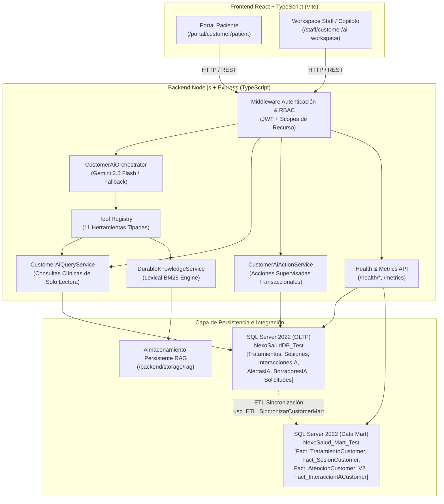
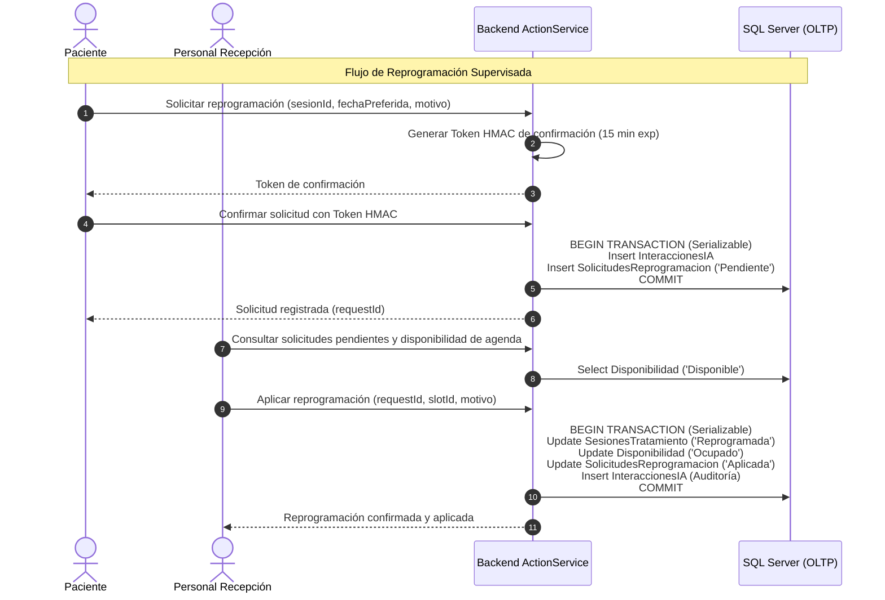

# PASO 9 — ARQUITECTURA TÉCNICA FINAL DEL AGENTE INTELIGENTE CUSTOMER
## NEXOSALUD — ASISTENCIA AL PACIENTE Y COPILOTO CLÍNICO-DOCUMENTAL

**Documento:** Especificación Arquitectónica y Diagramas del Sistema  
**Rama de Trabajo:** `customer`  
**Fecha de Publicación:** 2026-11-11  
**Versión:** 1.0.0-final  

---

## 1. VISIÓN GENERAL DE LA ARQUITECTURA

El Agente Inteligente CUSTOMER se inserta dentro de la plataforma empresarial de NexoSalud como un sistema de asistencia y copiloto híbrido, orquestando capacidades conversacionales basadas en LLM (Gemini), recuperación de documentos autorizados mediante RAG (BM25), persistencia transaccional de auditoría clínica en Microsoft SQL Server (OLTP) y consolidación analítica en el Data Mart institucional.

---

## 2. COMPONENTES Y RESPONSABILIDADES

### 2.1. Frontend React & Experiencia de Usuario
- **Portal Paciente:** Diseñado para autogestión de citas, seguimiento de avance operativo de tratamientos, lectura de indicaciones aprobadas y diálogo contextual con el asistente.
- **Workspace Clínico (Odontólogo):** Panel de alta eficiencia médica para inspección de atenciones realizadas, atención justificada de alertas clínicas y ciclo de vida documental de borradores (preparación -> revisión -> aprobación explícita -> emisión oficial).
- **Consola de Recepción:** Panel operativo para revisión de agendas, visualización de slots disponibles y confirmación oficial de reprogramaciones.

### 2.2. Capa de Aplicación y Orquestación (Backend)
- **CustomerAiOrchestrator:** Gestiona el ciclo conversacional del LLM. Aplica system instructions con restricciones de abstención clínica y orquesta la ejecución determinística de tools. Implementa resiliencia activa con fallback determinístico si Gemini excede el timeout de 10 segundos.
- **ToolRegistry:** Catálogo de 11 herramientas de function calling autorizadas, tipadas con JSON Schema y gobernadas por permisos de rol (`PACIENTE`, `ODONTOLOGO`, `RECEPCION`, `ADMIN`).
- **DurableKnowledgeService & BM25:** Motor de recuperación lexical que opera sobre documentos institucionales autorizados en formato Markdown/JSON, persistidos en disco y controlados por listas de acceso (ACL).
- **Health & Metrics Collector:** Módulo desacoplado en memoria que expone endpoints de liveness, readiness y telemetría de percentiles p50/p95 para observabilidad operativa continua.

### 2.3. Capa de Datos y Persistencia
- **NexoSaludDB (OLTP):** Base de datos relacional transaccional que contiene las entidades clínicas fundamentales y las cuatro tablas operativas del agente (`InteraccionesIA`, `AlertasIA`, `BorradoresIA`, `SolicitudesReprogramacionCustomer`). Protegida por constraints relacionales CHECK anti-diagnóstico.
- **NexoSalud_Mart (Data Mart):** Almacén analítico dimensional en esquema estrella, sincronizado mediante el procedimiento almacenado idempotente `dbo.usp_ETL_SincronizarCustomerMart`.

---

## 3. FLUJO TRANSACCIONAL DE ACCIONES SUPERVISADAS

---

## 4. GOBERNANZA CLÍNICA Y TRIPLE BARRERA ANTI-DIAGNÓSTICO

La integridad asistencial está blindada en tres capas independientes:
1. **Capa LLM:** System prompt con regla taxativa de abstención ante solicitudes de diagnóstico o prescripción médica.
2. **Capa Lógica de Negocio:** Servicios de TypeScript que exigen revisión y firma humana obligatoria (`requiresHumanReview: true`).
3. **Capa Motor de Base de Datos:** Restricción CHECK en SQL Server (`CK_InteraccionesIA_NoDiagnostico` y `CK_BorradoresIA_NoDiagnostico`) que aborta a nivel de transacción cualquier intento de registro diagnóstico por la IA.
