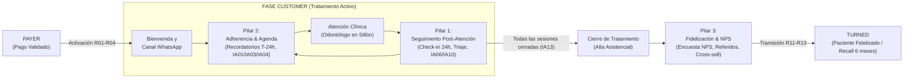
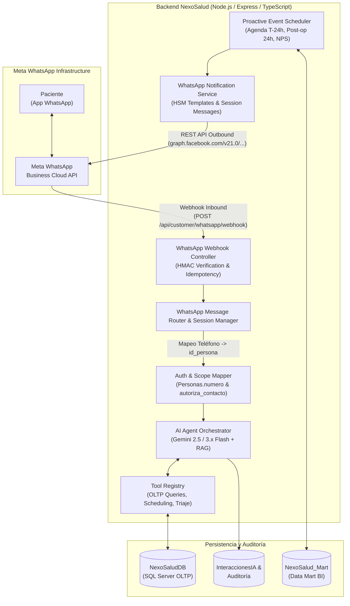
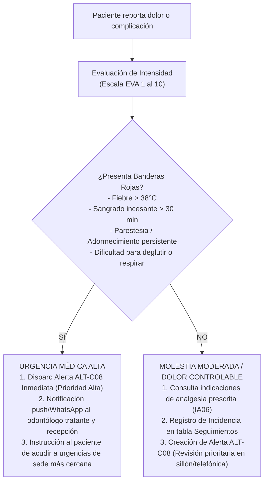
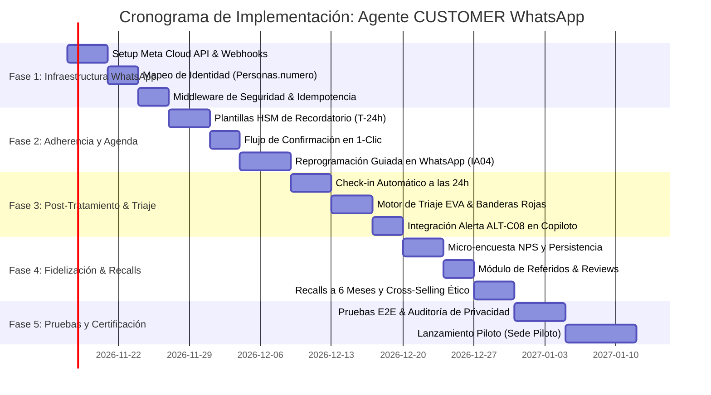

# Plan Maestro de Transformación: Agente Inteligente CUSTOMER Multi-Canal (WhatsApp First)

**Proyecto:** NexoSalud — Sistema de Gestión Odontológica  
**Módulo:** Agente Inteligente Fase CUSTOMER (Asistencia, Adherencia, Seguimiento y Retención)  
**Canal Primario:** WhatsApp (Meta WhatsApp Business Cloud API) + Portal Web del Paciente  
**Versión:** 1.0 — Arquitectura Integral  
**Fecha:** Noviembre 2026  

---

## 1. Visión y Objetivos Estratégicos

### 1.1. Propósito
Transformar el Agente Inteligente de la fase **CUSTOMER** de un asistente pasivo y estrictamente reactivo (limitado al chat web del portal) a un **asistente proactivo multicanal centrado en WhatsApp**. El agente acompañará al paciente en todo su ciclo de vida clínico: desde que se activa su tratamiento tras la validación de pago en PAYER, pasando por la ejecución y adherencia de sus sesiones, hasta el seguimiento de su recuperación, la medición de su satisfacción (NPS) y su transición fluida a la fidelización (TURNED).



### 1.2. Metas Cuantitativas de la Implementación
1. **Adherencia:** Reducir la tasa de inasistencias (*no-shows*) del 18 % al $\le 5\ %$ mediante confirmaciones interactivas por WhatsApp a T-24h y T-2h.
2. **Seguimiento Clínico:** Alcanzar el 95 % de contacto efectivo post-procedimiento invasivo a las 24 horas y resolver dudas postatención en $< 2$ minutos.
3. **Satisfacción y Retención:** Medir NPS en más del 70 % de los tratamientos concluidos (meta NPS $\ge 80$) y capturar al menos un 15 % de recomendaciones o contrataciones de tratamientos complementarios preventivos/estéticos.

---

## 2. Arquitectura de Integración WhatsApp (Meta Cloud API)

### 2.1. Componentes del Ecosistema WhatsApp



### 2.2. Consideraciones Clave de Mensajería WhatsApp
1. **Ventana de Conversación de 24 Horas:**
   - **Mensajes iniciados por el usuario (Inbound):** Abren una ventana libre de 24 horas donde el agente responde en lenguaje natural fluido.
   - **Mensajes iniciados por la clínica (Outbound proactivos):** Requieren el uso de **Plantillas Aprobadas (HSM - Highly Structured Messages)**:
     - `recordatorio_cita_v1` (Confirmar / Reprogramar).
     - `seguimiento_postoperatorio_v1` (Check-in 24h).
     - `encuesta_satisfaccion_v1` (Calificación 1-10).
     - `recordatorio_control_preventivo_v1` (Recall 6 meses).
2. **Seguridad y Consentimiento (Opt-In / Opt-Out):**
   - El número celular debe coincidir con `Personas.numero` y contar con `Personas.autoriza_contacto = 1`.
   - Soporte automático para palabras clave de desuscripción: *"DETENER"*, *"CANCELAR COMUNICACIONES"*, *"NO ENVIAR MAS"*, desactivando de inmediato `autoriza_contacto` con confirmación auditada.
3. **Idempotencia y Anti-Replay:**
   - Deduplicación estricta usando el identificador único `wamid` provisto por WhatsApp para evitar procesamiento o respuestas duplicadas.

---

## 3. Pilar 1: Seguimiento Post-Tratamiento y Triaje de Urgencias

### 3.1. Flujo de Check-in Proactivo (24h / 48h Post-Atención)
Cuando un odontólogo cierra una atención clínica con procedimientos clasificados como invasivos (extracciones, cirugías periodontales, endodoncias, implantes):
1. **Trigger de Backend:** El procedimiento de cierre (`usp_CerrarSesionClinica`) o el scheduler registra un evento en cola `POSTCARE_CHECKIN_QUEUE` programado a $T+24\text{ h}$.
2. **Disparo Saliente por WhatsApp:**
   ```text
   Hola [Nombre], te saluda el asistente de atención de NexoSalud. 
   Ayer tuviste tu sesión de [Servicio/Procedimiento] con el Dr. [Profesional].
   
   ¿Cómo te has sentido hoy? Por favor responde con un número del 1 al 3:
   1. Me siento muy bien, sin molestias significativas.
   2. Tengo molestias leves o inflamación esperada.
   3. Tengo dolor fuerte, sangrado continuo u otra complicación.
   ```
3. **Procesamiento de Respuesta:**
   - **Opción 1 (Evolución favorable):** El agente agradece, refuerza seguir las indicaciones vigentes (`getMyAftercareInstructions`) y registra la novedad en `Seguimientos` (`resultado: 'Evolucion favorable sin incidencias'`, `incidencia: false`).
   - **Opción 2 (Molestias leves esperadas):** El agente consulta las indicaciones emitidas, explica los cuidados antiinflamatorios aprobados (hielo local, dieta blanda) y recuerda la pauta de analgesia prescrita por su doctor.
   - **Opción 3 (Alerta / Complicación):** Se activa de inmediato el protocolo de triaje estructurado.

### 3.2. Protocolo de Triaje y Despistaje de Complicaciones
Si el paciente reporta dolor intenso o síntomas alarmantes en WhatsApp:



### 3.3. Entrega de Indicaciones Digitales por WhatsApp
- Cuando el odontólogo emite las indicaciones oficiales en la clínica, el paciente recibe automáticamente en su WhatsApp un mensaje maquetado con viñetas limpias:
  ```text
  📋 Indicaciones Postatención — NexoSalud
  Atención: Extracción Simple (Pieza 48) · 13/11/2026
  Odontólogo: Dra. Andrea Castro (COP 38491)

  Medicamentos prescritos:
  • Amoxicilina 500mg: 1 cápsula cada 8 horas por 5 días.
  • Ibuprofeno 400mg: 1 tableta cada 8 horas en caso de dolor por 3 días.

  Cuidados especiales:
  • Mantener gasa con presión firme durante 45 minutos.
  • No realizar buches, enjuagues ni escupir durante las primeras 24 horas.
  • Dieta blanda y fría. No usar cañita/pajilla.

  Si tienes dudas o notas molestias inusuales, solo escríbeme por aquí.
  ```

---

## 4. Pilar 2: Adherencia, Agenda y Citas de Control (Recalls)

### 4.1. Recordatorios Inteligentes Interactivos (T-24h y T-2h)
1. **Disparo Automatizado:** 24 horas antes del turno oficial, el scheduler evalúa las sesiones pendientes no confirmadas (resolviendo operativamente **ALT-C01**).
2. **Mensaje Interactivo con Botones de Respuesta Rápida:**
   ```text
   📅 Recordatorio de Cita — NexoSalud
   Hola Juan, tienes una cita programada:
   • Servicio: Ortodoncia - Sesión 3
   • Fecha: Viernes 14 de Noviembre
   • Hora: 16:30 hrs
   • Sede: San Isidro (Av. Javier Prado 1234)
   • Especialista: Dr. Carlos Mendoza

   Por favor confirma tu asistencia:
   [ Botón 1: ✅ Confirmar Asistencia ]
   [ Botón 2: 🔄 Reprogramar Fecha ]
   [ Botón 3: ❌ Cancelar Cita ]
   ```
3. **Acciones Deterministas:**
   - **Confirmar:** Actualiza `SesionesTratamiento.confirmacion_paciente = 'Confirmada'`, cierra la alerta ALT-C01 y notifica a recepción.
   - **Reprogramar:** Inicia el flujo conversacional de reprogramación en WhatsApp.

### 4.2. Flujo de Reprogramación Conversacional en WhatsApp (IA04)
El agente guía al paciente en 3 pasos rápidos sin obligarlo a ingresar contraseñas ni lidiar con interfaces complejas:
1. **Captura de Preferencia:** El paciente indica: *"Quiero cambiarla para el sábado 15 en la mañana"*.
2. **Búsqueda y Propuesta:** El agente invoca `prepareRescheduleRequest`, valida los cupos reales en `dbo.HorariosDisponibles` y responde:
   ```text
   Encontré estas 2 opciones disponibles para el sábado 15 en San Isidro:
   1. Sábado 15/11 a las 09:30 con Dr. Carlos Mendoza
   2. Sábado 15/11 a las 11:00 con Dr. Carlos Mendoza
   
   ¿Cuál prefieres? Responde 1 o 2.
   ```
3. **Generación de Solicitud:** Al elegir una opción, el agente genera la solicitud estructurada en `SolicitudesCustomerIA` en estado `'Pendiente'` para que recepción valide y aplique el cambio definitivo. La cita original no se libera hasta la confirmación de recepción.

### 4.3. Prevención de Abandono de Tratamiento (ALT-C03)
Para tratamientos contratados multisesión con sesiones no agendadas:
- **Día 7 sin agendar:** Recordatorio amigable del valor de la constancia para el éxito clínico del tratamiento.
- **Día 14 sin agendar:** Notificación prioritaria con opciones directas de agendamiento y alerta preventiva en la bandeja de recepción para llamada de reenganche.

### 4.4. Recalls Periódicos Preventivos (Puente Customer → Turned)
Cuando se ejecuta el cierre formal del tratamiento (IA13 / `usp_CerrarTratamientoYTransicionarTurned`):
1. El backend programa automáticamente un **Recall a los 6 meses** en la tabla `Seguimientos` con fecha proyectada $T+180\text{ días}$.
2. A los 6 meses, WhatsApp envía un mensaje de fidelización:
   ```text
   Hola María, ¡hace 6 meses finalizaste tu tratamiento de Ortodoncia con nosotros! 🦷✨
   Para mantener tu sonrisa sana y proteger los resultados obtenidos, es momento de tu revisión preventiva y limpieza periódica.
   
   ¿Te gustaría que te reservemos un espacio esta semana? Responde SÍ para ver horarios disponibles.
   ```

---

## 5. Pilar 3: Fidelización, Medición de Calidad (NPS) y Recomendación

### 5.1. Encuesta Conversacional CSAT / NPS (Micro-Encuesta en WhatsApp)
A las **72 horas del alta clínica** (o tras una sesión de gran impacto como finalización de rehabilitación o blanqueamiento):
1. **Pregunta NPS Estandarizada:**
   ```text
   Hola Carlos, en NexoSalud nos importa mucho tu bienestar y la calidad de nuestra atención.
   
   Del 0 al 10, ¿con qué probabilidad recomendarías NexoSalud a tus familiares o amigos?
   (Donde 0 es 'Nada probable' y 10 es 'Totalmente seguro')
   ```
2. **Persistencia y Segmentación Automática:**
   La respuesta se almacena en `Seguimientos.satisfaccion`:
   - **Promotores (Calificación 9 o 10):**
     - Agradecimiento caluroso.
     - **Incentivo a la recomendación:** *"¡Muchísimas gracias por tu confianza! Nos ayudaría muchísimo si compartes tu experiencia en Google: [Enlace Corto a Google Reviews]. ¡A tus amigos les encantará saberlo!"*
     - **Programa de Referidos:** Envío de un código de descuento preventivo para un familiar: *"Comparte tu código FAMILIA-CARLOS para una evaluación y profilaxis preventiva con 20% de descuento para un ser querido"*.
   - **Pasivos (Calificación 7 u 8):**
     - Agradecimiento: *"¿Qué detalle podríamos mejorar para que tu próxima visita sea un 10?"*. Registro de sugerencias en `Seguimientos.observaciones`.
   - **Detractores (Calificación 0 a 6):**
     - Empatía y contención: *"Lamentamos que tu experiencia no haya sido la esperada. ¿Podrías contarnos qué ocurrió?"*.
     - **Acción inmediata:** Apertura automática de un ticket de atención al cliente / incidencia en `Incidencias` y notificación al Administrador de Sede para llamada de recuperación en $< 24$ horas.

### 5.2. Sugerencia Ética de Tratamientos Complementarios (Cross-Selling Clínico)
El agente analizará la matriz de tratamientos afines autorizados para sugerir el siguiente paso clínico preventivo o estético:

| Tratamiento Concluido | Sugerencia Complementaria Ética | Momento de Activación |
| :--- | :--- | :--- |
| **Ortodoncia Completada** | Blanqueamiento dental estético + Retenedores de repuesto | A los 15 días del retiro de brackets |
| **Endodoncia Exitosa** | Restauración definitiva con corona/incrustación | A los 7 días post-endodoncia |
| **Profilaxis / Limpieza Profunda** | Tratamiento remineralizante con flúor / Férula nocturna | En la encuesta post-atención si refirió bruxismo |
| **Cirugía / Implante Integrado** | Fase protésica sobre implante | A los 3 meses post-colocación |

Al manifestar interés, el agente no crea contratos a ciegas: genera una nueva `Solicitud` en la etapa **LEAD/BUYER**, manteniendo la trazabilidad relacional intacta mediante el mismo `id_persona`.

---

## 6. Nuevas Herramientas (Tools) y Endpoints del Backend

### 6.1. Nuevas Herramientas en `toolRegistry.ts` (Perfil PACIENTE / AGENTE)
Para dotar al agente de estas capacidades por WhatsApp, se incorporan las siguientes herramientas:

```typescript
// 1. Registro de Triage y Sintomatología
{
  name: 'registerPatientSymptomTriage',
  description: 'Registra síntomas, nivel de dolor EVA (1-10) y banderas rojas reportadas por el paciente. Dispara alerta si requiere atención médica.',
  parameters: {
    painLevel: { type: 'integer', minimum: 0, maximum: 10 },
    symptoms: { type: 'string', maxLength: 300 },
    hasRedFlags: { type: 'boolean' },
    redFlagDetails: { type: 'string' }
  }
}

// 2. Registro de Encuesta NPS / Satisfacción
{
  name: 'recordPatientSatisfactionSurvey',
  description: 'Guarda la calificación de satisfacción/NPS del paciente (0 a 10) y comentarios en la tabla Seguimientos.',
  parameters: {
    score: { type: 'integer', minimum: 0, maximum: 10 },
    feedback: { type: 'string', maxLength: 500 },
    surveyType: { type: 'string', enum: ['POST_ATTENTION', 'TREATMENT_COMPLETION', 'RECALL'] }
  }
}

// 3. Confirmación Directa de Cita
{
  name: 'confirmSessionAttendance',
  description: 'Confirma la asistencia del paciente a su sesión programada en 1 paso desde WhatsApp.',
  parameters: {
    sessionId: { type: 'integer', minimum: 1 },
    confirmed: { type: 'boolean' }
  }
}

// 4. Registro de Oportunidad Complementaria
{
  name: 'createComplementaryTreatmentLead',
  description: 'Registra el interés del paciente en un servicio complementario hacia la etapa LEAD manteniendo su id_persona.',
  parameters: {
    serviceId: { type: 'integer', minimum: 1 },
    notes: { type: 'string', maxLength: 200 }
  }
}
```

### 6.2. Nuevas Rutas de API REST (`backend/src/routes/whatsapp.routes.ts`)
- `GET /api/customer/whatsapp/webhook`: Handshake de verificación de Meta con `hub.verify_token` y `hub.challenge`.
- `POST /api/customer/whatsapp/webhook`: Recepción de eventos y mensajes entrantes con verificación HMAC `X-Hub-Signature-256`.
- `POST /api/customer/whatsapp/outbound/schedule-run`: Endpoint interno para disparar el lote de recordatorios y check-ins diarios.

---

## 7. Plan de Ejecución y Cronograma Detallado



### Detalle de Fases de Ejecución:

#### **Fase 1: Infraestructura Base WhatsApp y Mapeo de Identidad (Semana 1)**
- Registro de WABA (WhatsApp Business Account) y número oficial de NexoSalud en Meta for Developers.
- Creación de rutas de webhook con validación estricta de firma HMAC (`sha256`).
- Servicio de resolución de contexto: dado el número de WhatsApp emisor (`+519XXXXXXXX`), localizar la entidad `Personas` en `NexoSaludDB` y verificar si cuenta con un tratamiento activo en `CUSTOMER`.
- Gestión de opt-in y consentimiento legal según Ley de Protección de Datos Personales (Ley 29733).

#### **Fase 2: Adherencia y Agendamiento en 1 Clic (Semana 2)**
- Configuración y aprobación de plantillas HSM para recordatorio de citas (T-24h y T-2h).
- Implementación de la herramienta `confirmSessionAttendance` para resolver la alerta ALT-C01 desde el chat.
- Adaptación de `prepareRescheduleRequest` (IA04) a menús numerados interactivos de WhatsApp.
- Cron job programado (`startCustomerAlertScheduler`) para despachar recordatorios matutinos.

#### **Fase 3: Seguimiento Post-Procedimiento y Triaje de Urgencias (Semana 3)**
- Disparador automático a las 24 horas del cierre de sesiones con procedimientos invasivos.
- Implementación de la herramienta `registerPatientSymptomTriage` con categorización de dolor y banderas rojas.
- Conexión directa con la bandeja del Odontólogo (Copiloto) para atención prioritaria de pacientes con complicaciones.
- Envío enriquecido de las indicaciones oficiales postatención (IA06) con formato WhatsApp.

#### **Fase 4: Satisfacción (NPS), Referidos y Recalls Preventivos (Semana 4)**
- Creación de la herramienta `recordPatientSatisfactionSurvey` y registro en `dbo.Seguimientos`.
- Lógica de bifurcación: Promotores $\rightarrow$ Enlace a Google Reviews + Código familiar; Detractores $\rightarrow$ Incidencia inmediata y escalamiento.
- Automatización de citas de control semestral (Recalls) tras el cierre formal del tratamiento (IA13), habilitando la transición controlada a la fase **TURNED**.
- Apertura de nuevas `Solicitudes` en LEAD para servicios complementarios solicitados.

#### **Fase 5: Certificación, Pruebas Integrales y Despliegue Piloto (Semana 5)**
- Validación de idempotencia ante reintentos de red y desconexiones de Meta.
- Pruebas de estrés y límites de tasa (*rate limiting*).
- Pruebas de seguridad: protección contra prompt injection por WhatsApp y aislamiento de datos entre pacientes.
- Despliegue en ambiente de producción con cohorte piloto inicial de 100 pacientes en una sede seleccionada.

---

## 8. Gobernanza, Privacidad y Resguardo Médico-Legal

1. **Intangibilidad de la Historia Clínica:** Los mensajes y conversaciones de WhatsApp son considerados herramientas de apoyo comunicacional y soporte administrativo. Las historias clínicas, diagnósticos y validaciones oficiales residen única y exclusivamente en `Atenciones` y `ValidacionesFicha` de `NexoSaludDB`, firmadas por el odontólogo habilitado.
2. **Confidencialidad:** El agente jamás enviará por WhatsApp diagnósticos reservados, imágenes íntimas intraorales no autorizadas ni datos de terceras personas.
3. **Control Profesional Absoluto:** Ningún cambio de medicación ni diagnóstico de urgencia es emitido por el modelo de lenguaje de forma autónoma. Todo reporte de molestia activa una alerta supervisada que debe ser atendida por personal de salud.
